<p align="center">
  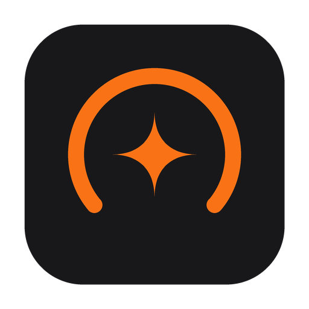
</p>

<h1 align="center">AI Usage Watcher</h1>

<p align="center">
  <em>Pemantau Desktop Kuota, Sesi Aktif &amp; Token Real-Time untuk Claude Code, Google Antigravity, OpenAI Codex CLI, Gemini CLI, OpenCode &amp; Ollama</em>
</p>

<p align="center">
  <strong>Language / Bahasa:</strong>
  <a href="README.md">English</a> |
  <b>Bahasa Indonesia</b>
</p>

<p align="center">
  <a href="https://github.com/silvkn1/ai-usage-watcher/releases"></a>
  <a href="https://github.com/silvkn1/ai-usage-watcher"></a>
  <a href="https://github.com/silvkn1/ai-usage-watcher"></a>
  <a href="LICENSE"></a>
</p>

**AI Usage Watcher** adalah widget desktop native Windows yang ringan beserta monitor system tray untuk memantau konsumsi token, estimasi biaya API, status sesi AI aktif, serta batas kuota berjalan (*rate limits*) dari **Claude Code**, **Google Antigravity (Gemini)**, **OpenAI Codex CLI**, **Gemini CLI**, **OpenCode**, dan **Ollama** lokal secara *real-time*.

Dibangun menggunakan C# Windows Forms murni di atas **.NET Framework 4.8** bawaan Windows: satu berkas `.exe` portabel berukuran ringan (~514 KB), tanpa instalasi runtime tambahan, tanpa dependensi Visual Studio/NuGet/Node, dan **tanpa pernah memakan taskbar** (`WS_EX_TOOLWINDOW`).

---

## 📸 Tampilan Antarmuka (UI Showcase)

### 1. Dashboard Multi-Provider & Pemantau Sesi Aktif (Mode Lengkap)
Dashboard paralel yang mendukung **kartu 2 kolom berpindah halaman (`1/2 ▸`)** maupun **grid 3 kolom** (`Claude Code`, `Antigravity`, `Codex CLI`, `Gemini CLI`, `OpenCode`) dengan ukuran kartu simetris dan telemetri sesi langsung.

<p align="center">
  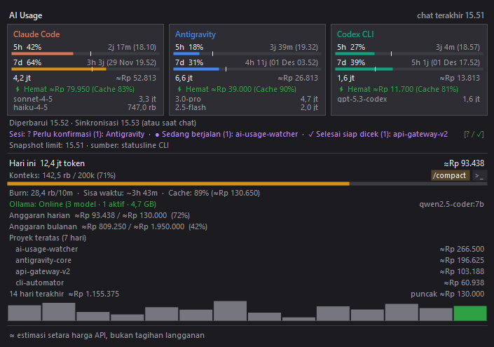
</p>

- **Bar Kuota 5 Jam & 7 Hari + Pacing Marker**: Hitung mundur waktu reset, jam reset lokal pasti, serta garis penanda laju (*pacing marker*) untuk memperingatkan jika kecepatan pemakaian berisiko menghabiskan kuota sebelum waktu reset.
- **Lencana Status Sesi Langsung**: Indikator status tiap sesi AI aktif — `?` (**Perlu konfirmasi** / input pengguna), `●` (**Sedang berjalan**), dan `✓` (**Selesai siap dicek**), lengkap dengan menu jump cepat (buka terminal, folder, VS Code, atau tandai selesai).
- **Bar Konteks Sesi Interaktif**: Mendeteksi batas konteks per model secara otomatis (`200k` / `400k` / `1M`), menampilkan persen pemakaian plus tombol salin **`/compact`** dan buka terminal aktif **`>_`**.
- **Penghematan Cache, VRAM Ollama & Sparkline**: Rincian penghematan *prompt cache* di tiap kartu, status `/api/ps` model + VRAM (`GB`) Ollama lokal, anggaran harian/bulanan, proyek teratas, dan grafik pengeluaran 14/30 hari.

---

### 2. Mini HUD Pill & Instant Hover-Expand (Mode Ringkas)
Bilah kapsul mengambang ramping setinggi 26px yang menempel di tepi layar dengan pilihan metrik Pill (`Semua penyedia aktif`, `Persen tertinggi`, atau `Biaya + Sisa waktu`) serta titik status sesi langsung (`●` / `?` / `✓`).

<p align="center">
  
</p>

- **Instant Hover-Expand**: Arahkan kursor ke atas Pill untuk langsung memekarkan dashboard penuh; jauhkan kursor 400ms agar menyusut kembali secara halus.
- **Double-Click Lock**: Klik ganda di luar tombol aksi untuk mengunci pergantian mode Pill maupun mode kartu lengkap.

---

### 3. Eksplorasi Biaya Proyek, Tren Penyedia 30 Hari & Detektor Sesi Terboros
Jendela analitik bertab lengkap (`Eksplorasi Biaya Proyek...` di menu tray/klik kanan) untuk mengaudit pengeluaran di seluruh penyedia AI, proyek, dan sesi.

<p align="center">
  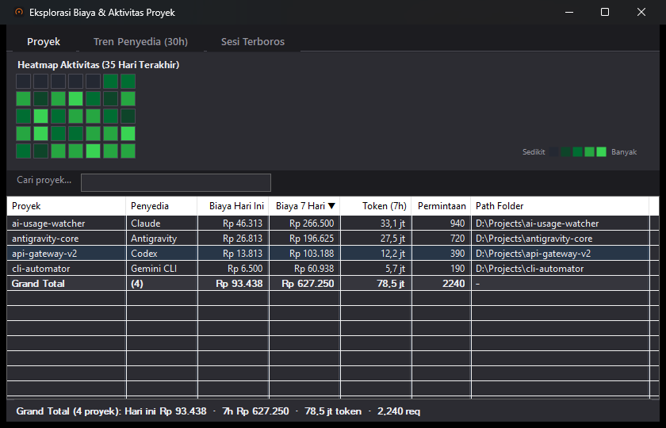
  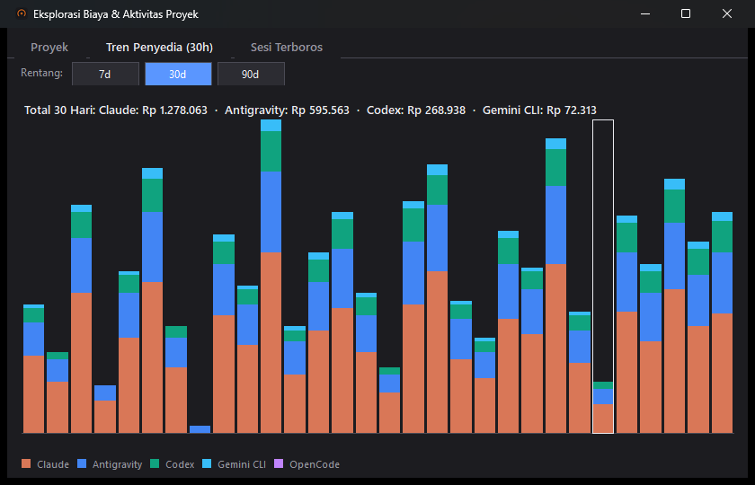
  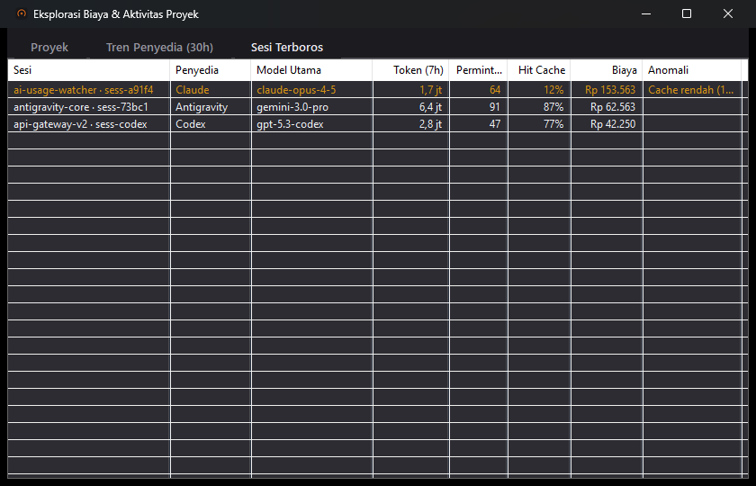
</p>

| Proyek & Heatmap 35 Hari | Tren Penyedia Bertumpuk (Stacked) | Detektor Sesi Terboros |
|---|---|---|
| Heatmap aktivitas 35 hari bergaya GitHub, kotak filter cepat, kolom tabel dapat diurutkan (*sort*), kolom Penyedia, footer Grand Total, serta aksi klik kanan (Buka Folder / Terminal / VS Code / Salin Markdown). | Grafik batang bertumpuk untuk membandingkan biaya harian **Claude**, **Antigravity**, **Codex**, **Gemini CLI**, dan **OpenCode** pada rentang **7d / 30d / 90d**. | Mengurutkan sesi berbiaya tertinggi dan menandai anomali seperti **Cache hit rendah (<25%)** atau **Biaya tinggi** agar alur prompting lebih hemat. |

---

### 4. Dialog Pengaturan Lengkap (Live Apply)

<p align="center">
  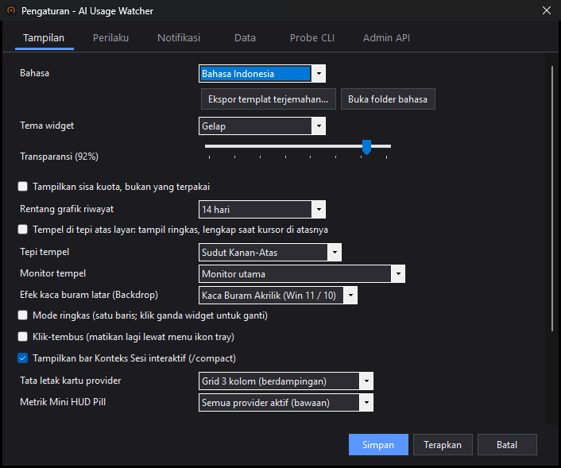
  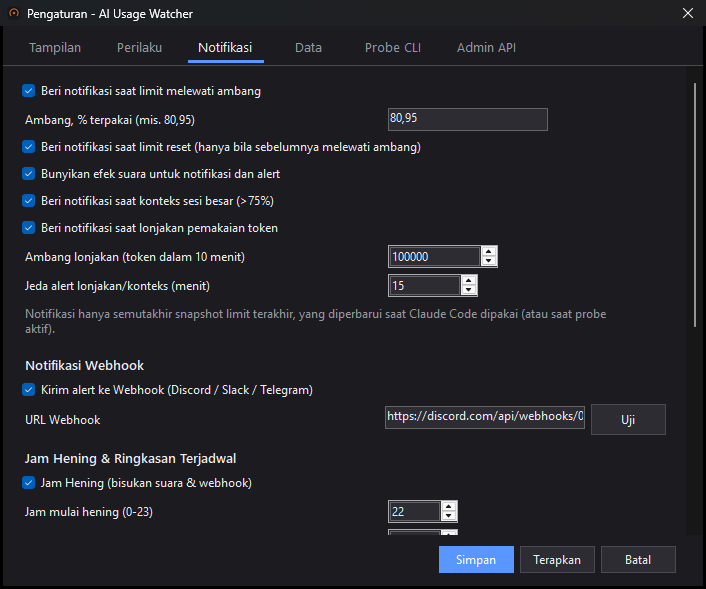
  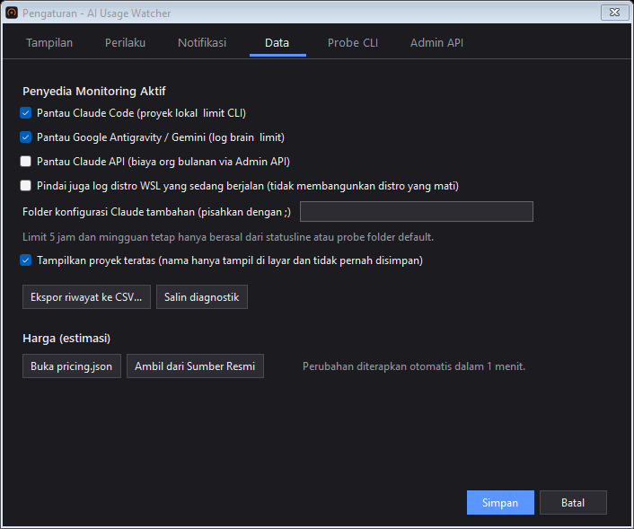
</p>

| Tampilan & Tata Letak | Notifikasi, Webhook & Jam Hening | Sumber Data, Ollama & Harga |
|---|---|---|
| Tema Gelap/Terang/Ikuti Windows, efek kaca buram Win11 Acrylic/Mica, slider transparansi, Mode Sisa, layout kartu 3+ penyedia, mode Mini Pill, konversi Rupiah otomatis Google Finance, dan tombol **Terapkan** langsung. | Ambang kuota (`80,95`), alert reset, peringatan konteks `>75%`, jeda cooldown lonjakan token, webhook Discord/Slack/Telegram terenkripsi DPAPI + tombol **Uji**, **Jam Hening**, **Ringkasan Terjadwal**, anggaran, dan hook Claude Code. | Aktif/nonaktif Claude Code, Antigravity, Codex CLI, Gemini CLI, OpenCode, deteksi Ollama (`port`), log WSL, ekspor CSV/JSON/Markdown, override `custom_pricing.json`, penarik harga resmi, dan ekspor/impor profil bebas rahasia. |

---

### 5. Panduan Penyiapan Awal, Menu Klik Kanan & Dialog Tentang

<p align="center">
  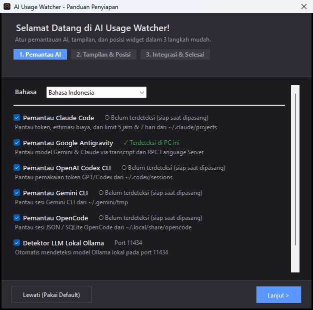
  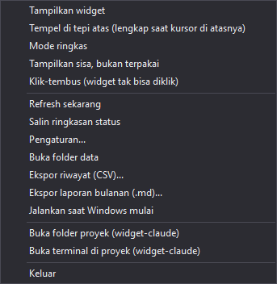
  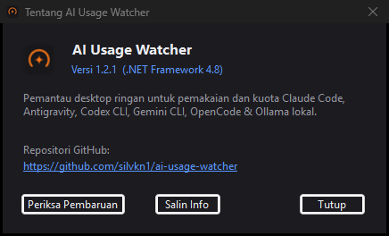
</p>

| Panduan Penyiapan (3 Langkah) | Menu Klik Kanan Terkelompok | Dialog Tentang (About) |
|---|---|---|
| Otomatis mendeteksi tool AI terpasang, mengatur bahasa, tema/efek kaca/posisi sudut layar, serta opsi memasang ekstensi status bar VS Code / Cursor. | Submenu rapi (**Tampilan & Posisi**, **Laporan & Alat**, **Bantuan & Tentang**) di ikon tray maupun klik kanan widget, ditambah pintasan cepat folder/terminal proyek aktif. | Diakses lewat **Bantuan & Tentang -> Tentang...** — menampilkan versi aplikasi, runtime `.NET 4.8`, tautan repositori GitHub resmi, tombol periksa pembaruan, dan salin info. |

---

## 🏆 Mengapa AI Usage Watcher? (Perbandingan dengan Solusi Lain)

Sebagian besar alat pemantau AI (seperti `ccusage`, `cclimits`, atau skrip statusline CLI) hanya berupa utilitas terminal manual, terbatas pada satu penyedia AI, atau dibangun di atas runtime Electron yang berat. **AI Usage Watcher** dirancang khusus untuk developer Windows yang menginginkan visibilitas instan, pasif, dan hemat memori.

| Fitur / Parameter | **AI Usage Watcher** (Aplikasi Ini) | **CLI Tools** (mis. `ccusage`) | **Statusline Bawaan** | **Aplikasi GUI Electron** |
| :--- | :---: | :---: | :---: | :---: |
| **Dukungan Provider** | **Claude + Antigravity + Codex + Gemini CLI + OpenCode + Ollama** | Hanya Claude Code | Hanya Claude Code | Umumnya 1 provider |
| **Antarmuka (UI)** | **Mini HUD Pill (26px) + Kartu 3-Kolom + Explorer** | Teks terminal (harus diketik) | Bar status terminal | Jendela berat / webview |
| **Lencana Sesi Langsung** | **Ada** (`?` konfirmasi, `●` berjalan, `✓` selesai + menu jump) | Tidak ada | Tidak ada | Tidak ada |
| **System Tray Dinamis** | **Ada** (badge % kuota 5 jam, warna dinamis & popup klik kiri) | Tidak ada | Tidak ada | Jarang / ikon statis |
| **Ukuran Biner** | **~514 KB** (Satu Berkas `.exe` Mandiri) | ~5 - 50 MB (Node.js/npm) | Skrip bash/ps1 | 150 MB - 300 MB+ |
| **Konsumsi Memori (RAM)** | **~20 - 35 MB** (Native .NET 4.8) | Menumpang runtime CLI | 0 MB (saat print saja) | 200 MB - 600 MB+ |
| **Dependensi Eksternal** | **Nol** (Bawaan Windows 10/11) | Perlu Node.js / Python | Perlu wrapper CLI | Perlu Node / Chromium |
| **Prediksi Habis Kuota (Runway)**| **Ada** (`Sisa waktu: ~3j 43m` + *pacing marker*) | Tidak ada | Tidak ada | Tidak ada |
| **Konversi Mata Uang Otomatis** | **Ada** (Kurs live Google Finance ke Rupiah / lokal) | Tidak ada (USD saja) | Tidak ada | Terbatas / Manual |
| **Integrasi Resmi Antigravity** | **Ada** (Connect-RPC ke Language Server lokal) | Tidak ada | Tidak ada | Tidak ada |
| **Klik-Tembus & Zero Taskbar** | **Ada** (`WS_EX_TOOLWINDOW` & tembus klik) | N/A | N/A | Memenuhi taskbar & `Alt+Tab` |
| **Laporan & Ekspor** | **Tren 30h, Detektor Anomali, `.md`, CSV & JSON** | JSON/teks terbatas | Tidak ada | CSV dasar |
| **Notifikasi & Webhook** | **Audio, Jam Hening, Digest Terjadwal, Discord/Slack/Telegram** | Tidak ada | Tidak ada | Tergantung plugin |
| **Privasi Kode & Prompt** | **100% Lokal** (konten dibuang sebelum parse) | 100% Lokal | 100% Lokal | Bervariasi / Telemetri |

---

## ✨ Fitur Utama

### 📊 Pemantauan Multi-Provider AI
- **Log Lokal Claude Code (`~/.claude/projects/**/*.jsonl`)**: Memindai token prompt, output, dan cache secara inkremental dengan deduplikasi lintas file `message.id | requestId`, deteksi konfirmasi tool (`AskUserQuestion` / `ExitPlanMode`), dan hook prompt izin tool.
- **Log Lokal Antigravity (`~/.gemini/antigravity/brain/**/transcript.jsonl`)**: Pemantau *real-time* transkrip Gemini & Claude di Antigravity (termasuk fallback `transcript_full.jsonl` saat record terpotong dan deteksi `BlockedOnUser`).
- **Log Lokal OpenAI Codex CLI (`~/.codex/sessions/**/rollout-*.jsonl`)**: Membaca metadata sesi Codex, `turn_context`, `last_token_usage` inkremental, dan `rate_limits` 5-jam / mingguan, termasuk pemindaian sesi di WSL2.
- **Pemindai Gemini CLI & OpenCode**: Memantau sesi Gemini CLI (`~/.gemini/tmp/**/chats/session-*.json`) dan OpenCode (`~/.local/share/opencode/storage/message/**/*.json`, plus fallback query read-only `sqlite3` CLI bila tersedia di PATH) dengan cache offset file persisten (`scan_cache.json`).
- **Detektor LLM Lokal Ollama & VRAM (`/api/tags` & `/api/ps`)**: Port dapat diatur (default `11434`), menampilkan indikator hijau live, jumlah model, model yang dimuat di memori beserta ukuran VRAM (`GB`).
- **Rate Limits Resmi via Connect-RPC Antigravity**: Mengambil persentase kuota langsung dari Language Server latar belakang (`RetrieveUserQuotaSummary`) melalui deteksi socket `hub_*.json`.
- **Layout Kartu Fleksibel & Kustomisasi**: Pilih tata letak otomatis, pengalih halaman 2 kolom (`1/2 ▸`), atau grid 3 kolom; kustomisasi mode Mini HUD Pill (`Semua penyedia`, `Persen tertinggi`, `Biaya + Sisa`); aktif/nonaktifkan provider secara mandiri di Pengaturan maupun Panduan Penyiapan.

### ⚡ Produktivitas, Ekstensi IDE & Pelaporan
- **Status Bar Pendamping VS Code & Cursor**: Pasang sekali klik dari menu tray untuk menyalin ekstensi ke `%USERPROFILE%\.vscode\extensions` dan `%USERPROFILE%\.cursor\extensions`. Menampilkan persentase kuota, biaya, dan penghematan cache di footer editor dengan menu Quick Pick untuk refresh paksa, buka Eksplorasi Biaya Proyek, toggle mode ringkas, atau salin `/compact` dan ringkasan status.
- **Efek Kaca Buram Windows 11 (Mica & Acrylic)**: Efek transparan Desktop Window Manager (DWM) asli (**Acrylic Blur**, **Mica**, **Mica Alt**, atau **Solid**) dengan sudut membulat Win11 dan Per-Monitor DPI.
- **Snap Multi-Monitor & Tempel 4 Sudut Layar**: Pilih monitor tujuan dan tempel widget dengan presisi ke 4 sudut (**Kiri-Atas**, **Kanan-Atas**, **Kiri-Bawah**, **Kanan-Bawah**) atau tepi tengah layar.
- **Konteks Sesi Interaktif & Aksi Cepat**:
  - Klik **`/compact`** di Bar Konteks untuk menyalin perintah `/compact`; klik **`>_`** untuk membuka terminal di folder proyek aktif terakhir (`LastActiveCwd`).
  - Klik ganda kartu Claude untuk membuka terminal (`wt.exe` diprioritaskan), kartu Antigravity untuk membuka foldernya, atau area luar untuk toggle mode Pill/Lengkap.
- **Override Harga Kustom (`custom_pricing.json`)**: Atur tarif per 1 juta token untuk OpenRouter, Bedrock, Vertex AI, API proxy, atau model khusus — prioritas lebih tinggi dari `pricing.json` dan penarik harga resmi.
- **Ekspor Lengkap & Companion JSON**: Ekspor riwayat CSV (koma atau titik koma Excel regional), JSON riwayat harian, laporan bulanan `AI_Usage_Report_YYYY_MM.md`, dan ekspor live `~/.ai-usage-status.json` untuk shell prompt / tmux / skrip kustom.
- **Cadangan Profil Portabel**: Ekspor dan impor profil pengaturan JSON tanpa menyertakan kredensial sensitif (kunci API Admin & URL webhook otomatis dikeluarkan).
- **Global Hotkey**: Tekan `Win+Alt+U` (otomatis fallback ke `Ctrl+Alt+U`) di mana saja untuk menampilkan/menyembunyikan widget.

### 🔔 Notifikasi Cerdas & Otomasi
- **Notifikasi Aktivitas & Konfirmasi Sesi**: Mendeteksi saat Claude Code atau Antigravity menunggu konfirmasi pengguna (`?`) atau selesai berjalan (`✓`), memunculkan lencana `?` beserta opsi toast/suara/webhook.
- **Alert Ambang Kuota & Reset**: Ambang kustom (default `80,95`), notifikasi saat limit me-reset, peringatan konteks `>75%`, serta deteksi lonjakan pemakaian 10 menit dengan jeda *cooldown*.
- **Discord / Slack / Telegram Webhooks**: Format payload otomatis per platform, tombol **Uji** di Pengaturan, menghormati jadwal **Jam Hening**, dan mendukung **Ringkasan Harian / Mingguan Terjadwal**.
- **Auto-Updater Terverifikasi**: Memeriksa GitHub Releases dengan pembatasan host HTTPS resmi, verifikasi checksum SHA-256, dan validasi tanda tangan Authenticode PE.

---

## 🚀 Panduan Pemasangan (Instalasi Cepat)

### Prasyarat
- Windows 10 (versi 1903+) atau Windows 11.
- .NET Framework 4.8 (sudah terpasang bawaan di Windows).
- Salah satu tool yang didukung: Claude Code CLI, Google Antigravity, OpenAI Codex CLI, Gemini CLI, OpenCode, atau Ollama.

### Instalasi Otomatis
1. Unduh rilis terbaru `AIUsageWatcher-<versi>.zip` dari [Releases](https://github.com/silvkn1/ai-usage-watcher/releases) atau build dari kode sumber.
2. Ekstrak arsip zip, buka PowerShell di folder tersebut, dan jalankan:
   ```powershell
   powershell -NoProfile -ExecutionPolicy Bypass -File .\install.ps1 -Statusline -Autostart
   ```
   *Parameter opsional:*
   - `-Autostart`: Menjalankan widget otomatis saat Windows mulai.
   - `-Statusline`: Memasang pembungkus statusline Claude Code CLI agar sisa kuota 5j/7h terbaca otomatis.
   - `-InstallDir <path>`: Menentukan lokasi instalasi kustom (default: `%LOCALAPPDATA%\Programs\AIUsageWatcher`).

3. Selesai! Aplikasi langsung berjalan di system tray dan membuka Panduan Penyiapan 3 langkah pada pemakaian pertama.

> **Tips untuk alert `?` izin tool Claude Code**: Di **Pengaturan -> Notifikasi** (atau Panduan Penyiapan), klik **Pasang hook** agar event `Notification` dari Claude Code mengirim sinyal konfirmasi (`Bash`/`Edit`/`Write`) secara instan.

### Mode Portabel (Tanpa Instalasi)
Buat berkas kosong bernama `portable.flag` di sebelah `AIUsageWatcher.exe`. Seluruh konfigurasi, riwayat, cache, dan log disimpan di folder lokal `.\data` tanpa menulis Registry Windows.

---

## 🛠️ Build dari Kode Sumber

Aplikasi dapat dikompilasi menggunakan kompiler bawaan Windows `.NET Framework 4.8` (`csc.exe`) tanpa Visual Studio maupun paket pihak ketiga:

```powershell
# Kompilasi biner (menghasilkan dist\AIUsageWatcher.exe)
powershell -NoProfile -ExecutionPolicy Bypass -File .\build.ps1

# Kompilasi paket distribusi lengkap (.zip + SHA256SUMS.txt)
powershell -NoProfile -ExecutionPolicy Bypass -File .\build.ps1 -Package

# Menjalankan 89 automated unit tests
powershell -NoProfile -ExecutionPolicy Bypass -File .\test.ps1
```

---

## 📁 Struktur Berkas

```
ai-usage-watcher/
├── src/
│   ├── AudioAlert.cs          # Pengelola audio chime peringatan ambang batas
│   ├── AutoUpdater.cs         # Pembaruan otomatis GitHub Releases, SHA-256 & validasi PE
│   ├── Common.cs              # Path sistem, formatting, minimal JSON parser, dan ProcessHelper
│   ├── CompanionInstaller.cs  # Pemasang & sinkronisasi ekstensi status bar VS Code / Cursor
│   ├── Config.cs              # Model konfigurasi, enkripsi DPAPI & ekspor/impor profil aman
│   ├── Diag.cs                # Pembuat laporan diagnostik bebas data rahasia
│   ├── FloatingForm.cs        # Jendela mengambang HUD (kartu 3-kol/paged, Pill, Bar Konteks, GDI+)
│   ├── History.cs             # Buku riwayat harian mandiri (120 hari), ekspor CSV & JSON
│   ├── Hooks.cs               # Global hotkey listener & listener hook Claude Code
│   ├── LangPacks.cs           # Pemuat paket bahasa JSON eksternal
│   ├── Logic.cs               # Evaluasi limit, pacing, runway, Jam Hening, Digest & laporan Markdown
│   ├── Probe.cs               # Eksekutor probe CLI headless untuk limit Claude Code
│   ├── Program.cs             # Entry point Windows Forms & single-instance mutex
│   ├── ProjectExplorerForm.cs # Eksplorasi Proyek: heatmap 35h, Tren Penyedia 30h & Sesi Terboros
│   ├── SettingsForm.cs        # Dialog pengaturan bertab dengan pratinjau Apply langsung
│   ├── SetupWizardForm.cs     # Panduan penyiapan awal 3 langkah
│   ├── Sources.cs             # Pembaca rate limit, penarik harga resmi, Ollama & klien Connect-RPC
│   ├── Strings.cs             # Mesin lokalisasi dwibahasa (English & Bahasa Indonesia)
│   ├── Theming.cs             # Palet warna, efek Win11 DWM Mica/Acrylic & ekstraksi ikon aplikasi
│   ├── TrayApp.cs             # Ikon tray dinamis, pemantau berkas, menu terkelompok & dialog Tentang
│   ├── Usage.cs               # Pemindai log & status sesi (Claude/AG/Codex/GeminiCLI/OpenCode)
│   └── Webhook.cs             # Pengirim webhook tahan SSRF (Discord, Slack, Telegram & Generic)
├── companion/                 # Ekstensi status bar VS Code & Cursor
├── statusline/                # Skrip wrapper statusline Claude Code CLI (PowerShell & Bash)
├── tests/
│   └── UnitTests.cs           # 89 automated unit tests (.NET 4.8 test runner mandiri)
├── assets/                    # Aset logo aplikasi (PNG vektor & .ico)
├── docs/img/                  # Tangkapan layar fitur untuk dokumentasi
│   ├── en/                    # Tangkapan layar antarmuka English
│   └── id/                    # Tangkapan layar antarmuka Bahasa Indonesia
├── app.ico                    # Ikon executable bawaan Windows
├── app.manifest               # Manifest DPI awareness dan izin eksekusi Windows
├── pricing.json               # Tabel harga token resmi bawaan
├── build.ps1                  # Skrip kompilasi otomatis dengan csc.exe native
├── test.ps1                   # Skrip eksekusi unit test
├── install.ps1                # Skrip instalasi per-user dan registrasi statusline
└── uninstall.ps1              # Skrip uninstalasi bersih (opsi hapus data pengguna)
```

---

## 🔒 Privasi & Keamanan Data

- **100% Pemrosesan Lokal**: Seluruh log percakapan diproses secara lokal di PC Anda. Tidak ada server analitik, telemetri, atau isi percakapan yang dikirim ke internet.
- **Pembersihan Konten Percakapan**: Pemindai log hanya mengekstrak metadata (`usage`, `model`, `timestamp`, penanda konfirmasi tool, `cwd`). Konten prompt dan jawaban dibuang dari memori serta tidak pernah ditulis ke disk.
- **Enkripsi Kredensial DPAPI**: Kunci API Admin dan URL webhook dienkripsi memakai Windows DPAPI (*Data Protection API*) terikat akun Windows pengguna aktif.
- **Pembatasan Jaringan & Pembaruan Ketat**: Auto-updater membatasi koneksi HTTPS ke host resmi `github.com` / `api.github.com` disertai verifikasi SHA-256 dan Authenticode; webhook & koneksi lokal menegakkan validasi SSRF dan allowlist host ketat.
- **Integritas Rilis & Kebijakan Code Signing**: Build CI berbasis tag menerbitkan GitHub Build Provenance Attestations dan mendukung Authenticode signing gratis melalui [SignPath.io](https://signpath.io/) / [SignPath Foundation](https://signpath.org/) — lihat [`CODE_SIGNING_POLICY.md`](CODE_SIGNING_POLICY.md).

---

## 📄 Lisensi

Didistribusikan di bawah [Lisensi MIT](LICENSE). Silakan gunakan, modifikasi, dan distribusikan secara bebas.
