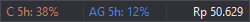

<p align="center">
  
</p>

<h1 align="center">AI Usage Watcher</h1>

<p align="center">
  <em>Real-time Desktop Quota &amp; Token Monitor for Claude Code and Google Antigravity</em>
</p>

<p align="center">
  <strong>Language / Bahasa:</strong>
  <a href="README.md">English</a> |
  <b>Bahasa Indonesia</b>
</p>

<p align="center">
  <a href="https://github.com"></a>
  <a href="https://github.com"></a>
  <a href="https://github.com"></a>
  <a href="LICENSE"></a>
</p>

**AI Usage Watcher** adalah aplikasi widget desktop ringan (native Windows) dan monitor system tray untuk memantau konsumsi token, estimasi biaya API, serta batas kuota (*rate limits*) dari **Claude Code** dan **Google Antigravity (Gemini)** secara *real-time*.

Dibuat menggunakan C# Windows Forms murni pada **.NET Framework 4.8** bawaan Windows: berukuran sangat kecil (~300 KB), tanpa instalasi runtime tambahan, tanpa dependensi Visual Studio atau paket NuGet eksternal, dan **tanpa pernah memakan taskbar** (*zero taskbar clutter*).

---

## 📸 Tampilan Antarmuka (UI Showcase)

### 1. Dual-Column Cards Dashboard (Mode Lengkap)
Tampilan dashboard paralel yang menampilkan metrik Claude Code dan Antigravity secara simetris, memangkas tinggi widget hingga lebih dari 50% agar tetap nyaman di layar.

<p align="center">
  
</p>

*Menampilkan bar kuota 5 jam & 7 hari untuk Claude Code dan Google Antigravity, penanda laju (*pacing marker*), jadwal sinkronisasi & jam reset pasti, estimasi biaya dalam USD dan konversi Rupiah langsung, metrik burn rate & estimasi runway kuota, breakdown 2 model teratas, serta riwayat pengeluaran 7 hari. Klik ganda pada kartu Claude membuka terminal proyek langsung, sedangkan kartu Antigravity membuka foldernya.*

---

### 2. Mini HUD Pill & Instant Hover-Expand (Mode Ringkas)
Mode minimalis untuk produktivitas tanpa gangguan: hanya berupa bilah kapsul ramping setinggi 26px di sudut layar Anda.

<p align="center">
  
</p>

- **Instant Hover-Expand**: Arahkan kursor ke atas Pill, widget otomatis membesar menjadi kartu lengkap. Jauhkan kursor 400ms, widget kembali menyusut menjadi Pill.
- **Double-Click Lock**: Klik ganda pada widget untuk mengunci permanen antara mode Pill atau kartu lengkap.

---

### 3. Dialog Pengaturan Lengkap (Settings GUI)

<p align="center">
  
  
  
</p>

| Tampilan & Kurs Mata Uang | Peringatan & Webhook | Sumber Data & Harga Resmi |
|---|---|---|
| Tema Gelap/Terang/Ikuti Windows, Transparansi, Mode Sisa, serta Konversi Rupiah dengan kurs otomatis dari Google Finance. | Ambang batas limit (80%, 95%), peringatan konteks `/compact`, lonjakan token *burn rate*, efek audio, dan webhook Discord/Slack. | Pemindaian Claude & Google Antigravity, WSL, dan penarik harga resmi API dari dokumentasi Anthropic & Google. |

---

### 4. Menu Cepat System Tray

<p align="center">
  
</p>

*Akses instan untuk menampilkan/menyembunyikan widget, toggle mode ringkas, tempel di tepi atas, salin ringkasan status ke clipboard, segarkan data, ekspor riwayat CSV & laporan bulanan Markdown (.md), hingga navigasi langsung ke folder proyek Claude aktif.*

---

## 🏆 Mengapa AI Usage Watcher? (Perbandingan dengan Solusi Lain)

Sebagian besar alat pemantau AI (seperti `ccusage`, `cclimits`, atau skrip statusline CLI) hanya berupa utilitas terminal interaktif, terbatas pada satu penyedia AI, atau aplikasi berbasis Electron yang berat. **AI Usage Watcher** dirancang khusus untuk pengguna desktop Windows yang membutuhkan pemantauan kuota instan, pasif, dan tanpa beban sistem.

| Fitur / Parameter | **AI Usage Watcher** (Aplikasi Ini) | **CLI Tools** (mis. `ccusage`) | **Statusline Bawaan** | **Aplikasi GUI Electron** |
| :--- | :---: | :---: | :---: | :---: |
| **Dukungan Provider** | **Claude Code + Antigravity (Gemini)** | Hanya Claude Code | Hanya Claude Code | Umumnya hanya 1 provider |
| **Bentuk Antarmuka (UI)** | **Mini HUD Pill (26px) + Dual Cards** | Teks terminal (harus diketik) | Bar status terminal | Jendela berat / webview |
| **System Tray Dinamis** | **Ada** (angka badge & warna dinamis) | Tidak ada | Tidak ada | Jarang / ikon statis |
| **Ukuran Biner / Distro** | **~300 KB** (Single Standalone .exe) | ~5 - 50 MB (Node.js/npm) | Berkas skrip bash/ps1 | 150 MB - 300 MB+ |
| **Konsumsi Memori (RAM)** | **~20 - 35 MB** (Native .NET 4.8) | Menumpang runtime CLI | 0 MB (hanya saat print) | 200 MB - 600 MB+ |
| **Dependensi Eksternal** | **Nol** (Bawaan Windows 10/11) | Perlu Node.js / Python | Perlu wrapper CLI | Perlu Node / Chromium |
| **Prediksi Habis Kuota (Runway)**| **Ada** (`Runway: ~45m` + pacing marker) | Tidak ada | Tidak ada | Tidak ada |
| **Konversi Mata Uang Otomatis** | **Ada** (Kurs live Google Finance ke IDR) | Tidak ada (hanya USD) | Tidak ada | Terbatas / Manual |
| **Integrasi Resmi Antigravity** | **Ada** (Connect-RPC ke Language Server) | Tidak ada | Tidak ada | Tidak ada |
| **Klik-Tembus & Zero Taskbar** | **Ada** (`WS_EX_TOOLWINDOW` & transparent) | Tidak relevan | Tidak relevan | Mengotori taskbar & Alt+Tab |
| **Aksi Produktivitas Cepat** | **Double-click terminal launch & copy status** | Ketik perintah manual | Tidak ada | Terbatas |
| **Laporan & Ekspor** | **Markdown (.md) bulanan & CSV** | Ekspor JSON/teks terbatas | Tidak ada | CSV dasar |
| **Peringatan & Webhook** | **Audio chimes, toast reset, Discord/Slack** | Tidak ada | Tidak ada | Tergantung plugin |
| **Privasi Kode & Prompt** | **100% Lokal** (konten dibuang sebelum parse) | 100% Lokal | 100% Lokal | Bervariasi / Telemetri |

### 💡 Keunggulan Utama yang Membedakan:
1. **Dukungan Simultan Claude Code & Google Antigravity**: Satu-satunya monitor yang menampilkan metrik penggunaan token, biaya, dan kuota 5h/7d dari dua ekosistem AI coding terdepan secara berdampingan dalam satu dashboard terpadu.
2. **Koneksi Resmi Connect-RPC ke Antigravity**: Membaca kuota resmi Antigravity langsung dari Language Server lokal (`127.0.0.1`) melalui daemon socket `hub_*.json` tanpa scraping web atau risiko token expired.
3. **Mini HUD Pill & Zero Taskbar Clutter**: Widget mengambang setinggi 26 piksel yang menempel di tepi layar, tembus klik (*click-through*), dan otomatis membesar saat disentuh kursor (*instant hover-expand*) tanpa pernah memakan ruang taskbar Windows atau mengganggu jendela kerja `Alt+Tab`.
4. **Analitik Cerdas & Runway Forecast**: Tidak hanya menampilkan persentase pasif, aplikasi memprediksi kapan kuota Anda habis berdasarkan laju konsumsi 10 menit terakhir, lengkap dengan penanda *pacing marker* untuk mencegah limit terputus di tengah sesi coding.
5. **Kompak, Mandiri, dan Portabel**: Tanpa installer rumit, tanpa dependensi Node.js/npm/Python, dan cukup satu berkas `.exe` portabel berukuran 300 KB yang langsung jalan di setiap PC Windows 10 dan 11.

---

## ✨ Fitur Utama

### 📊 Pemantauan Multi-Provider AI (Claude Code + Google Antigravity)
- **Log Lokal Claude Code (`~/.claude/projects/**/*.jsonl`)**: Pindai token prompt, output, serta cache secara inkremental dan dedup lintas file dengan waktu lokal.
- **Log Lokal Antigravity (`~/.gemini/antigravity/brain/**/transcript.jsonl`)**: Pemantau *real-time* transkrip Google Antigravity untuk menghitung token model Gemini 2.5/3.0 Pro & Flash serta model pihak ketiga (Claude Opus/Sonnet di Antigravity).
- **Rate Limits Resmi via Connect-RPC**: Mengambil persentase sisa kuota resmi Antigravity langsung dari background Language Server (`RetrieveUserQuotaSummary`) melalui deteksi otomatis berkas daemon `hub_*.json` pada loopback `127.0.0.1`.
- **Rate Limits 5 Jam & 7 Hari**: Menghitung konsumsi kuota berjalan 5 jam (*rolling 5-hour window*) dan mingguan untuk Claude maupun Antigravity, lengkap dengan countdown waktu dan jam reset pasti e.g. `17h 59m (24 Nov 02:00)`.
- **Prediksi Habis Kuota (Runway Forecast)**: Memperkirakan sisa menit/jam sampai kuota habis (`Runway: ~45m`) secara dinamis saat laju konsumsi aktif (`TokensLast10m > 5.000`).
- **Breakdown Model Teratas pada Kartu**: Memperlihatkan 2 model paling banyak digunakan beserta total tokennya (mis. `Sonnet 3.5 1.8M`, `Haiku 3.5 600K`) langsung di kartu provider.
- **Penanda Laju (Pacing Marker)**: Garis putih pada bar menunjukkan rasio waktu yang telah berlalu dibanding persentase kuota yang terpakai. Peringatan otomatis jika laju pemakaian diprediksi menghabiskan kuota sebelum waktu reset.
- **Jadwal Sinkronisasi & Info Pembaruan**: Menampilkan statusline pembaruan data `Diperbarui [jam] · Sinkronisasi [jam berikutnya] (atau saat chat)` agar pengguna selalu tahu kapan kuota disegarkan.
- **Seleksi Provider Fleksibel**: Pengguna dapat mengaktifkan atau menonaktifkan pemantauan Claude, Gemini/Antigravity, atau Admin API secara independen melalui tab Pengaturan Data. Tampilan widget otomatis beradaptasi menjadi Single Card saat hanya 1 provider aktif, atau Dual Cards saat keduanya aktif.

### ⚡ Produktivitas & Laporan (Aksi Cepat)
- **Eksplorasi Biaya Proyek & Heatmap Aktivitas 35 Hari**: Dialog GUI khusus (`Eksplorasi Biaya Proyek...` di tray) dengan Heatmap kontribusi aktivitas 35 hari (5 minggu x 7 hari) gaya GitHub yang memperlihatkan densitas token harian dan tooltip rincian. Dilengkapi tabel proyek per direktori dengan tombol "Buka Folder", "Buka Terminal", dan "Salin Markdown".
- **Penghematan Prompt Cache & Hit Rate**: Indikator hijau langsung di kartu provider: `⚡ Hemat ≈$X.XX (Cache YY%)` untuk mengetahui seberapa besar efisiensi biaya dari caching prompt.
- **Global Hotkey Bawaan**: Tekan `Win+Alt+U` (dengan fallback otomatis ke `Ctrl+Alt+U`) di mana saja untuk menampilkan/menyembunyikan widget secara instan.
- **Ekspor Status JSON Pendamping**: Mengekspor ringkasan status real-time ke `~/.ai-usage-status.json` dan `<AppData>\status.json` untuk integrasi status bar terminal, tmux, shell prompt, atau skrip eksternal.
- **Detektor Otomatis LLM Lokal Ollama**: Mendeteksi instans lokal Ollama (`http://127.0.0.1:11434`) secara otomatis dan mengekspor jumlah serta daftar model ke status JSON.
- **Quick Launch via Double-Click**:
  - *Klik ganda kartu Claude*: Membuka terminal CMD baru langsung di folder direktori kerja proyek terakhir (`LastActiveCwd`).
  - *Klik ganda kartu Antigravity*: Membuka folder Antigravity langsung di Windows Explorer.
  - *Klik ganda area luar*: Beralih cepat antara mode ringkas (Pill) dan mode kartu lengkap.
- **Salin Ringkasan Status Sekali Klik**: Opsi `Salin ringkasan status` di menu klik-kanan widget & tray menyalin ringkasan format Markdown siap pakai untuk ditempel ke tim atau catatan.
- **Ekspor Laporan Bulanan Markdown (.md)**: Fitur ekspor `AI_Usage_Report_YYYY_MM.md` yang merangkum total request, token, estimasi biaya (USD & IDR), tabel model aktif, dan rincian pemakaian harian.
- **Ekspor Riwayat CSV**: Ekspor seluruh riwayat harian agregat ke format CSV standar atau Excel regional (pemisah titik koma).

### 🌐 Pengambilan Harga Resmi & Kurs Otomatis
- **Official Pricing Auto-Fetcher**: Mengambil harga list resmi per juta token langsung dari dokumentasi [Anthropic Pricing Docs](https://platform.claude.com/docs/en/about-claude/pricing) dan [Google AI Studio Pricing Docs](https://ai.google.dev/gemini-api/docs/pricing).
- **Google Finance Currency Converter**: Kurs konversi mata uang (mis. USD ke IDR) diambil otomatis dari pencarian Google Finance secara berkala, menampilkan nominal setara Rupiah secara akurat.

### 🔔 Notifikasi Cerdas & Integrasi Webhook
- **Smart Quota Reset Toast Notification**: Pemberitahuan toast balon dan nada audio saat jendela kuota 5 jam atau 7 hari selesai me-reset ke 0%.
- **Threshold Alerts**: Notifikasi saat pemakaian mencapai ambang batas (default: 80% dan 95%).
- **Session Context Alert**: Memantau ukuran konteks sesi aktif terhadap batas 200k token; memberi peringatan jika mencapai >75% (150k token) agar Anda tahu kapan waktu yang tepat menjalankan `/compact`.
- **Burn Rate Spike Detector**: Mendeteksi lonjakan token tidak wajar dalam jendela 10 menit terakhir (default: >100k token / 10 menit).
- **Audio Chimes**: Efek suara notifikasi sistem Windows untuk setiap peristiwa penting.
- **Discord / Slack / Telegram Webhook**: Kirim peringatan otomatis ke channel tim Anda saat limit mendekati batas atau lonjakan pengeluaran terjadi.

### 🪟 Desain Khusus Windows (Zero Distraction)
- **Zero Taskbar Footprint**: Jendela floating menggunakan `WS_EX_TOOLWINDOW` dan `ShowInTaskbar = false`, tidak pernah mengotori taskbar maupun menu `Alt+Tab`.
- **Ikon Tray Dinamis**: Menampilkan lencana angka persen limit 5 jam dengan pewarnaan dinamis (Hijau <50%, Kuning 50-79%, Merah ≥80%).
- **Sembunyi Otomatis Saat Layar Penuh**: Widget otomatis bersembunyi saat Anda menonton video layar penuh, presentasi, atau bermain game, lalu kembali saat selesai.
- **Klik-Tembus (*Click-Through*)**: Widget bisa dibuat tembus klik mouse agar tidak menghalangi interaksi kode di IDE.
- **DPI-Aware & Sudut Membulat**: Teks tajam di resolusi 100%, 125%, 150%, 200%, dan mendukung sudut membulat modern Windows 11.

---

## 🚀 Panduan Pemasangan (Instalasi Cepat)

### Prasyarat
- Windows 10 (versi 1903+) atau Windows 11.
- .NET Framework 4.8 (sudah terpasang bawaan di Windows).
- Claude Code CLI / Google Antigravity.

### Instalasi Otomatis
1. Unduh rilis terbaru `AIUsageWatcher-<versi>.zip` atau build sendiri dari repositori ini.
2. Ekstrak file zip, lalu buka PowerShell di folder tersebut dan jalankan:
   ```powershell
   powershell -NoProfile -ExecutionPolicy Bypass -File .\install.ps1 -Statusline -Autostart
   ```
   *Parameter opsional:*
   - `-Autostart`: Menjalankan aplikasi secara otomatis saat Windows dinyalakan.
   - `-Statusline`: Memasang wrapper statusline Claude Code CLI agar sisa kuota terbaca otomatis.
   - `-InstallDir <path>`: Menentukan lokasi instalasi kustom (default: `%LOCALAPPDATA%\Programs\AIUsageWatcher`).

3. Selesai! Aplikasi akan langsung berjalan di system tray Anda.

### Mode Portabel (Tanpa Instalasi)
Cukup buat berkas kosong bernama `portable.flag` di samping file `AIUsageWatcher.exe`. Aplikasi akan menyimpan semua konfigurasi, riwayat, dan log di dalam folder lokal `.\data` tanpa menyentuh registry Windows.

---

## 🛠️ Build dari Kode Sumber

Aplikasi ini dapat di-build secara mandiri menggunakan kompiler bawaan Windows tanpa perlu menginstal Visual Studio atau dependensi pihak ketiga:

```powershell
# Kompilasi aplikasi (menghasilkan dist\AIUsageWatcher.exe)
powershell -NoProfile -ExecutionPolicy Bypass -File .\build.ps1

# Kompilasi paket distribusi rilis lengkap (.zip + SHA256)
powershell -NoProfile -ExecutionPolicy Bypass -File .\build.ps1 -Package

# Menjalankan 33 automated unit test suite
powershell -NoProfile -ExecutionPolicy Bypass -File .\test.ps1
```

---

## 📁 Struktur Berkas

```
ai-usage-watcher/
├── src/
│   ├── AudioAlert.cs      # Pengelola audio chime peringatan ambang batas
│   ├── Common.cs          # Path sistem, formatting token/mata uang, dan minimal JSON parser
│   ├── Config.cs          # Model konfigurasi aplikasi & penyimpanan terenkripsi DPAPI
│   ├── FloatingForm.cs    # Jendela mengambang (Dual-Column Cards, Mini HUD Pill, GDI+ paint)
│   ├── History.cs         # Penyimpanan riwayat harian mandiri (120 hari), ekspor CSV & Markdown
│   ├── Hooks.cs           # Global keyboard shortcut / hotkey listener
│   ├── Logic.cs           # Mesin evaluasi ambang limit, pacing, runway, status, & eksportir laporan
│   ├── Probe.cs           # Eksekutor probe CLI untuk pembacaan limit Claude desktop
│   ├── Program.cs         # Entry point aplikasi Windows Forms & single-instance mutex
│   ├── SettingsForm.cs    # Dialog antarmuka pengaturan bertab (Display, Behavior, Alerts, Data)
│   ├── Sources.cs         # Rate limit reader, Official Pricing fetcher, dan Connect-RPC client
│   ├── Strings.cs         # Sistem lokalisasi dwibahasa (English & Bahasa Indonesia)
│   ├── Theming.cs         # Palette warna, tema gelap/terang, dan ekstraksi app icon
│   ├── TrayApp.cs         # Pengelola tray icon dinamis, file watcher, menu konteks, dan timer
│   ├── Usage.cs           # Pemindai log lokal inkremental Claude Code & Antigravity
│   └── Webhook.cs         # Pengirim payload alert ke Discord, Slack, & Telegram
├── statusline/            # Pembungkus statusline untuk Claude Code CLI (PowerShell & Bash)
├── tests/
│   └── UnitTests.cs       # 33 automated unit tests (.NET 4.8 test runner mandiri)
├── assets/                # Aset ikon aplikasi (vektor minimalis 2-warna & icon format .ico)
├── docs/img/              # Tangkapan layar fitur untuk dokumentasi
│   ├── id/                # Tangkapan layar antarmuka Bahasa Indonesia
│   └── en/                # Tangkapan layar antarmuka English
├── app.ico                # Ikon aplikasi bawaan Windows executable
├── app.manifest           # Manifest DPI awareness dan hak eksekusi Windows
├── pricing.json           # Tabel harga token resmi bawaan aplikasi
├── build.ps1              # Skrip kompilasi otomatis menggunakan csc.exe native
├── test.ps1               # Skrip eksekusi unit test runner
├── install.ps1            # Skrip instalasi per-user dan registrasi statusline
└── uninstall.ps1          # Skrip uninstalasi bersih (opsional hapus data pengguna)
```

---

## 🔒 Privasi & Keamanan Data

- **100% Pemrosesan Lokal**: Seluruh log percakapan diproses di PC Anda. Tidak ada server analitik, telemetri, atau data percakapan yang dikirim ke internet.
- **Pembersihan Konten Percakapan**: Pemindai log hanya mengambil field `usage`, `model`, dan `timestamp`. Konten percakapan dibuang dari memori sebelum parsing JSON dan tidak pernah disimpan ke disk.
- **Enkripsi Kredensial DPAPI**: Kunci API Admin atau token webhook disimpan dengan enkripsi Windows DPAPI (*Data Protection API*) terikat pada akun Windows pengguna saat ini.

---

## 📄 Lisensi

Didistribusikan di bawah lisensi MIT. Silakan gunakan, modifikasi, dan distribusikan secara bebas.
