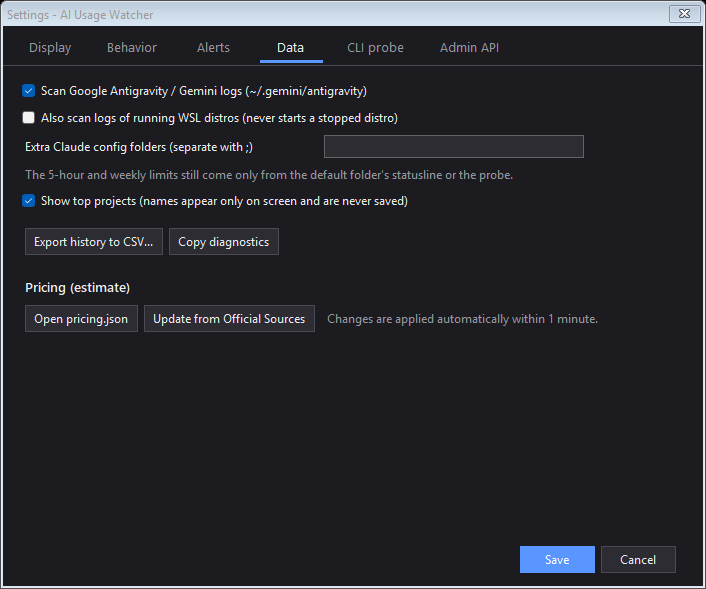
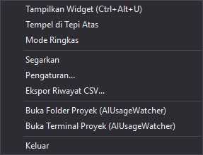

# AI Usage Watcher

[](https://github.com)
[-darkgreen.svg)](https://github.com)
[](https://github.com)
[-brightgreen.svg)](https://github.com)
[](LICENSE)

**AI Usage Watcher** adalah aplikasi widget desktop ringan (native Windows) dan monitor system tray untuk memantau konsumsi token, estimasi biaya API, serta batas kuota (*rate limits*) dari **Claude Code** dan **Google Antigravity (Gemini)** secara *real-time*.

Dibuat menggunakan C# Windows Forms murni pada **.NET Framework 4.8** bawaan Windows: berukuran sangat kecil (~220 KB), tanpa instalasi runtime tambahan, tanpa dependensi Visual Studio atau paket NuGet eksternal, dan **tanpa pernah memakan taskbar** (*zero taskbar clutter*).

---

## 📸 Tampilan Antarmuka (UI Showcase)

### 1. Dual-Column Cards Dashboard (Mode Lengkap)
Tampilan dashboard paralel yang menampilkan metrik Claude Code dan Antigravity secara simetris, memangkas tinggi widget hingga lebih dari 50% agar tetap nyaman di layar.

<p align="center">
  
</p>

*Menampilkan bar kuota 5 jam & 7 hari untuk Claude Code dan Google Antigravity, penanda laju (*pacing marker*), jam reset, estimasi biaya dalam USD dan konversi Rupiah langsung, metrik burn rate & konteks percakapan, serta grafik riwayat pengeluaran 7 hari.*

---

### 2. Mini HUD Pill & Instant Hover-Expand (Mode Ringkas)
Mode minimalis untuk produktivitas tanpa gangguan: hanya berupa bilah kapsul ramping setinggi 26px di sudut layar Anda.

<p align="center">
  
</p>

- **Instant Hover-Expand**: Arahkan kursor ke atas Pill, widget otomatis membesar menjadi kartu lengkap. Jauhkan kursor 400ms, widget kembali menyusut menjadi Pill.
- **Double-Click Lock**: Klik ganda pada widget untuk mengunci permanen antara mode Pill atau kartu lengkap.

---

### 3. Dialog Pengaturan Lengkap (Settings GUI)

<p align="center">
  
  
  
</p>

| Tampilan & Kurs Mata Uang | Peringatan & Webhook | Sumber Data & Harga Resmi |
|---|---|---|
| Tema Gelap/Terang/Ikuti Windows, Transparansi, Mode Sisa, serta Konversi Rupiah dengan kurs otomatis dari Google Finance. | Ambang batas limit (80%, 95%), peringatan konteks `/compact`, lonjakan token *burn rate*, efek audio, dan webhook Discord/Slack. | Pemindaian Claude & Google Antigravity, WSL, dan penarik harga resmi API dari dokumentasi Anthropic & Google. |

---

### 4. Menu Cepat System Tray

<p align="center">
  
</p>

*Akses instan untuk menampilkan/menyembunyikan widget, toggle mode ringkas, tempel di tepi atas, segarkan data, ekspor riwayat CSV, hingga navigasi langsung ke folder proyek Claude aktif.*

---

## ✨ Fitur Utama

### 📊 Pemantauan Multi-Provider AI (Claude Code + Google Antigravity)
- **Log Lokal Claude Code (`~/.claude/projects/**/*.jsonl`)**: Pindai token prompt, output, serta cache secara inkremental dan dedup lintas file dengan waktu lokal.
- **Log Lokal Antigravity (`~/.gemini/antigravity/brain/**/transcript.jsonl`)**: Pemantau *real-time* transkrip Google Antigravity untuk menghitung token model Gemini 2.5/3.0 Pro & Flash.
- **Rate Limits 5 Jam & 7 Hari**: Menghitung konsumsi kuota berjalan 5 jam (*rolling 5-hour window*) dan mingguan untuk Claude maupun Antigravity, lengkap dengan countdown waktu dan jam reset pasti.
- **Penanda Laju (Pacing Marker)**: Garis putih pada bar menunjukkan rasio waktu yang telah berlalu dibanding persentase kuota yang terpakai. Peringatan otomatis jika laju pemakaian diprediksi menghabiskan kuota sebelum waktu reset.

### 🌐 Pengambilan Harga Resmi & Kurs Otomatis
- **Official Pricing Auto-Fetcher**: Mengambil harga list resmi per juta token langsung dari dokumentasi [Anthropic Pricing Docs](https://platform.claude.com/docs/en/about-claude/pricing) dan [Google AI Studio Pricing Docs](https://ai.google.dev/gemini-api/docs/pricing).
- **Google Finance Currency Converter**: Kurs konversi mata uang (mis. USD ke IDR) diambil otomatis dari pencarian Google Finance secara berkala, menampilkan nominal setara Rupiah secara akurat.

### 🔔 Notifikasi Cerdas & Integrasi Webhook
- **Threshold Alerts**: Notifikasi saat pemakaian mencapai ambang batas (default: 80% dan 95%) serta saat kuota ter-reset.
- **Session Context Alert**: Memantau ukuran konteks sesi aktif terhadap batas 200k token; memberi peringatan jika mencapai >75% (150k token) agar Anda tahu kapan waktu yang tepat menjalankan `/compact`.
- **Burn Rate Spike Detector**: Mendeteksi lonjakan token tidak wajar dalam jendela 10 menit terakhir (default: >100k token / 10 menit).
- **Audio Chimes**: Efek suara notifikasi sistem Windows untuk setiap peristiwa penting.
- **Discord / Slack / Telegram Webhook**: Kirim peringatan otomatis ke channel tim Anda saat limit mendekati batas atau lonjakan pengeluaran terjadi.

### 🪟 Desain Khusus Windows (Zero Distraction)
- **Zero Taskbar Footprint**: Jendela floating menggunakan `WS_EX_TOOLWINDOW` dan `ShowInTaskbar = false`, tidak pernah mengotori taskbar maupun menu `Alt+Tab`.
- **Ikon Tray Dinamis**: Menampilkan lencana angka persen limit 5 jam dengan pewarnaan dinamis (Hijau <50%, Kuning 50-79%, Merah ≥80%).
- **Sembunyi Otomatis Saat Layar Penuh**: Widget otomatis bersembunyi saat Anda menonton video layar penuh, presentasi, atau bermain game, lalu kembali saat selesai.
- **Klik-Tembus (*Click-Through*)**: Widget bisa dibuat tembus klik mouse agar tidak menghalangi interaksi kode di IDE.
- **DPI-Aware & Sudut Membulat**: Teks tajam di resolusi 100%, 125%, 150%, 200%, dan mendukung sudut membulat modern Windows 11.

---

## 🚀 Panduan Pemasangan (Instalasi Cepat)

### Prasyarat
- Windows 10 (versi 1903+) atau Windows 11.
- .NET Framework 4.8 (sudah terpasang bawaan di Windows).
- Claude Code CLI / Google Antigravity.

### Instalasi Otomatis
1. Unduh rilis terbaru `AIUsageWatcher-<versi>.zip` atau build sendiri dari repositori ini.
2. Ekstrak file zip, lalu buka PowerShell di folder tersebut dan jalankan:
   ```powershell
   powershell -NoProfile -ExecutionPolicy Bypass -File .\install.ps1 -Statusline -Autostart
   ```
   *Parameter opsional:*
   - `-Autostart`: Menjalankan aplikasi secara otomatis saat Windows dinyalakan.
   - `-Statusline`: Memasang wrapper statusline Claude Code CLI agar sisa kuota terbaca otomatis.
   - `-InstallDir <path>`: Menentukan lokasi instalasi kustom (default: `%LOCALAPPDATA%\Programs\AIUsageWatcher`).

3. Selesai! Aplikasi akan langsung berjalan di system tray Anda.

### Mode Portabel (Tanpa Instalasi)
Cukup buat berkas kosong bernama `portable.flag` di samping file `AIUsageWatcher.exe`. Aplikasi akan menyimpan semua konfigurasi, riwayat, dan log di dalam folder lokal `.\data` tanpa menyentuh registry Windows.

---

## 🛠️ Build dari Kode Sumber

Aplikasi ini dapat di-build secara mandiri menggunakan kompiler bawaan Windows tanpa perlu menginstal Visual Studio atau dependensi pihak ketiga:

```powershell
# Kompilasi aplikasi (menghasilkan dist\AIUsageWatcher.exe)
powershell -NoProfile -ExecutionPolicy Bypass -File .\build.ps1

# Kompilasi paket distribusi rilis lengkap (.zip + SHA256)
powershell -NoProfile -ExecutionPolicy Bypass -File .\build.ps1 -Package

# Menjalankan 18 automated unit test suite
powershell -NoProfile -ExecutionPolicy Bypass -File .\test.ps1
```

---

## 📁 Struktur Berkas

```
ai-usage-watcher/
├── src/
│   ├── Common.cs          # Path sistem, formatting token/mata uang, dan minimal JSON parser
│   ├── Config.cs          # Model konfigurasi aplikasi & penyimpanan terenkripsi DPAPI
│   ├── FloatingForm.cs    # Jendela mengambang (Dual-Column Cards, Mini HUD Pill, GDI+ paint)
│   ├── Logic.cs           # Mesin evaluasi ambang peringatan, pacing kalkulator, tray helper
│   ├── Probe.cs           # Eksekutor probe CLI untuk pembacaan limit Claude desktop
│   ├── SettingsForm.cs    # Dialog antarmuka pengaturan bertab (Display, Behavior, Alerts, Data)
│   ├── Sources.cs         # Rate limit reader, Official Pricing fetcher, dan Admin API
│   ├── Strings.cs         # Sistem lokalisasi dwibahasa (English & Bahasa Indonesia)
│   ├── TrayApp.cs         # Pengelola tray icon dinamis, file watcher, dan timer aplikasi
│   └── Usage.cs           # Pemindai log lokal inkremental Claude Code & Antigravity
├── statusline/            # Pembungkus statusline untuk Claude Code CLI (PowerShell & Bash)
├── tests/
│   └── UnitTests.cs       # 18 automated unit tests (.NET 4.8 test runner mandiri)
├── docs/img/              # Tangkapan layar fitur untuk dokumentasi
├── app.manifest           # Manifest DPI awareness dan hak eksekusi Windows
├── pricing.json           # Tabel harga token resmi bawaan aplikasi
├── build.ps1              # Skrip kompilasi otomatis menggunakan csc.exe native
├── test.ps1               # Skrip eksekusi unit test runner
├── install.ps1            # Skrip instalasi per-user dan registrasi statusline
└── uninstall.ps1          # Skrip uninstalasi bersih (opsional hapus data pengguna)
```

---

## 🔒 Privasi & Keamanan Data

- **100% Pemrosesan Lokal**: Seluruh log percakapan diproses di PC Anda. Tidak ada server analitik, telemetri, atau data percakapan yang dikirim ke internet.
- **Pembersihan Konten Percakapan**: Pemindai log hanya mengambil field `usage`, `model`, dan `timestamp`. Konten percakapan dibuang dari memori sebelum parsing JSON dan tidak pernah disimpan ke disk.
- **Enkripsi Kredensial DPAPI**: Kunci API Admin atau token webhook disimpan dengan enkripsi Windows DPAPI (*Data Protection API*) terikat pada akun Windows pengguna saat ini.

---

## 📄 Lisensi

Didistribusikan di bawah lisensi MIT. Silakan gunakan, modifikasi, dan distribusikan secara bebas.
