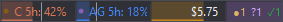
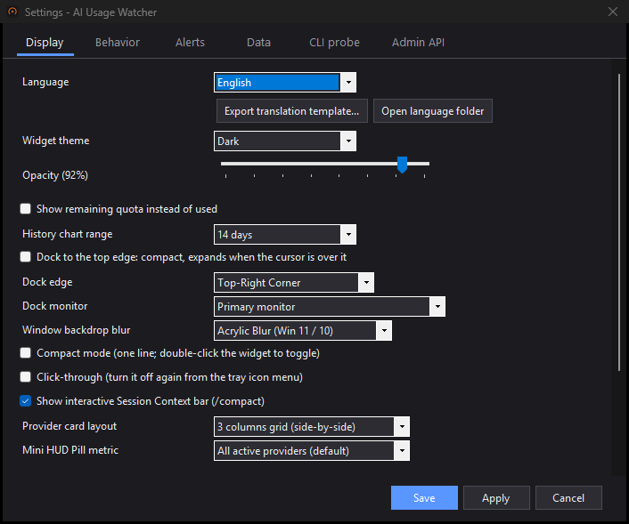
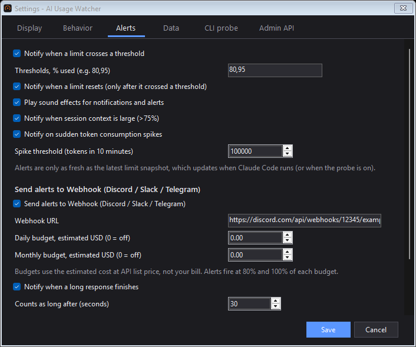
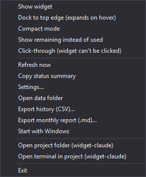

<p align="center">
  
</p>

<h1 align="center">AI Usage Watcher</h1>

<p align="center">
  <em>Real-time Desktop Quota &amp; Token Monitor for Claude Code and Google Antigravity</em>
</p>

<p align="center">
  <strong>Language / Bahasa:</strong>
  <b>English</b> |
  <a href="README.id.md">Bahasa Indonesia</a>
</p>

<p align="center">
  <a href="https://github.com"></a>
  <a href="https://github.com"></a>
  <a href="https://github.com"></a>
  <a href="LICENSE"></a>
</p>

**AI Usage Watcher** is a lightweight, native Windows desktop widget and system tray monitor for tracking token consumption, estimated API costs, and quota rate limits from **Claude Code** and **Google Antigravity (Gemini)** in real time.

Built with pure C# Windows Forms on the built-in **.NET Framework 4.8** of Windows: ultra-compact footprint (~300 KB), zero additional runtime installations, zero external NuGet or Node dependencies, and **zero taskbar clutter** (`WS_EX_TOOLWINDOW`).

---

## 📸 UI Showcase

### 1. Dual-Column Cards Dashboard (Full Mode)
A parallel dashboard displaying Claude Code and Antigravity metrics side-by-side symmetrically, reducing vertical height by over 50% for unobtrusive screen placement.

<p align="center">
  
</p>

*Displays 5-hour & 7-day quota bars for Claude Code and Google Antigravity, pacing markers, next sync schedule & exact reset timestamps, USD and dual-currency cost estimations, burn rate metrics & quota runway forecasts, top 2 models breakdown, and a 7-day spending sparkline. Double-clicking the Claude card opens the terminal directly in the project directory, while double-clicking the Antigravity card opens its folder.*

---

### 2. Mini HUD Pill & Instant Hover-Expand (Compact Mode)
A minimalist HUD designed for distraction-free coding: a sleek 26px capsule bar nestled at the edge of your screen.

<p align="center">
  
</p>

- **Instant Hover-Expand**: Hover your mouse over the pill, and the widget automatically expands into the full dual-card view. Move the cursor away for 400ms to smoothly collapse back into the pill.
- **Double-Click Lock**: Double-click anywhere on the widget to toggle and lock permanently between compact pill mode and full view.

---

### 3. Comprehensive Settings GUI

<p align="center">
  
  
  
</p>

| Display & Currency | Alerts & Webhooks | Data Sources & Pricing |
|---|---|---|
| Dark/Light/Follow Windows themes, transparency slider, Remaining mode toggle, and live currency conversion via Google Finance rates. | Quota threshold alerts (80%, 95%), `/compact` context window warnings, burn rate spike detectors, audio chimes, and Discord/Slack webhooks. | Toggle Claude & Google Antigravity scanners, WSL log detection, and automatic fetcher for official Anthropic & Google API pricing docs. |

---

### 4. System Tray Quick Menu

<p align="center">
  
</p>

*Instant right-click tray menu to show/hide widget, toggle compact mode, dock to top edge, copy markdown status summary to clipboard, refresh data, export CSV history & monthly Markdown (.md) reports, or navigate directly to active project directories.*

---

## 🏆 Why AI Usage Watcher? (Comparison with Other Solutions)

Most AI monitoring tools (such as `ccusage`, `cclimits`, or CLI statusline scripts) are purely interactive terminal commands, restricted to a single AI provider, or built on heavy Electron runtimes. **AI Usage Watcher** is tailored specifically for Windows desktop developers seeking instant, passive, and zero-overhead quota tracking.

| Feature / Dimension | **AI Usage Watcher** (This App) | **CLI Utilities** (e.g., `ccusage`) | **Built-in Statuslines** | **Electron GUI Apps** |
| :--- | :---: | :---: | :---: | :---: |
| **Provider Support** | **Claude Code + Antigravity (Gemini)** | Claude Code only | Claude Code only | Typically 1 provider |
| **Interface (UI)** | **Mini HUD Pill (26px) + Dual Cards** | Terminal text (must invoke) | Terminal status bar | Heavy window / webview |
| **Dynamic System Tray** | **Yes** (live badge percentage & color) | None | None | Rare / static icon |
| **Binary Size** | **~300 KB** (Single Standalone .exe) | ~5 - 50 MB (Node.js/npm) | Bash/PowerShell scripts | 150 MB - 300 MB+ |
| **Memory Footprint (RAM)** | **~20 - 35 MB** (Native .NET 4.8) | Absorbed in CLI runtime | 0 MB (execution only) | 200 MB - 600 MB+ |
| **External Dependencies** | **Zero** (Windows 10/11 built-in) | Requires Node.js / Python | Requires CLI wrapper | Requires Node / Chromium |
| **Runway Quota Forecast**| **Yes** (`Runway: ~45m` + pacing marker) | None | None | None |
| **Auto Currency Conversion** | **Yes** (Live Google Finance to local) | None (USD only) | None | Limited / Manual |
| **Official Antigravity Connect-RPC** | **Yes** (Direct Language Server RPC) | None | None | None |
| **Click-Through & Zero Taskbar** | **Yes** (`WS_EX_TOOLWINDOW` & transparent) | N/A | N/A | Clutters taskbar & Alt+Tab |
| **Quick Productivity Actions** | **Double-click terminal launch & copy status** | Manual commands | None | Limited |
| **Reporting & Exporting** | **Monthly Markdown (.md) & CSV** | Limited JSON/text | None | Basic CSV |
| **Alerts & Webhooks** | **Audio chimes, toast reset, Discord/Slack** | None | None | Plugin-dependent |
| **Code & Prompt Privacy** | **100% Local** (prompts discarded before parse) | 100% Local | 100% Local | Varies / Telemetry |

### 💡 Key Differentiators:
1. **Simultaneous Claude Code & Google Antigravity Monitoring**: The only tool presenting token consumption, costs, and 5h/7d rate limits from both leading AI coding environments side-by-side in one unified dashboard.
2. **Official Connect-RPC Language Server Integration**: Queries official Antigravity quota directly from the background Language Server (`127.0.0.1`) via local `hub_*.json` daemon discovery without web scraping or auth token expirations.
3. **Mini HUD Pill & Zero Taskbar Clutter**: Floating 26px capsule widget docked unobtrusively to screen edges, click-through capable, and instantly expanding on mouse hover without taking taskbar real estate or polluting `Alt+Tab`.
4. **Intelligent Analytics & Runway Forecasting**: Beyond static percentages, the app calculates when your quota will exhaust based on your 10-minute burn rate, complete with a visual pacing marker to prevent hitting limits mid-session.
5. **Compact, Portable, and Standalone**: No complex installers, no Node.js or Python dependencies—a single portable 300 KB `.exe` file that runs out of the box on Windows 10 and 11.

---

## ✨ Core Features

### 📊 Multi-Provider AI Monitoring (Claude Code + Google Antigravity)
- **Local Claude Code Logs (`~/.claude/projects/**/*.jsonl`)**: Incrementally scans prompt, output, and cache tokens with cross-file deduplication and local timestamps.
- **Local Antigravity Logs (`~/.gemini/antigravity/brain/**/transcript.jsonl`)**: Real-time transcript scanner for Google Antigravity models (Gemini 2.5/3.0 Pro & Flash, Claude Opus/Sonnet via Antigravity).
- **Official Connect-RPC Quota**: Retrieves remaining quota directly from the Antigravity Language Server (`RetrieveUserQuotaSummary`) by auto-discovering daemon sockets in `hub_*.json`.
- **Rolling 5-Hour & 7-Day Limits**: Tracks rolling 5-hour and 7-day rate limits for both Claude and Antigravity with countdown timers and exact reset timestamps, e.g., `17h 59m (24 Nov 02:00)`.
- **Runway Forecast**: Dynamically projects remaining minutes/hours until quota exhaustion (`Runway: ~45m`) when active consumption exceeds 5,000 tokens / 10 min.
- **Top 2 Models Breakdown**: Highlights the two most active AI models and their token volume (e.g., `Sonnet 3.5 1.8M`, `Haiku 3.5 600K`) directly on provider cards.
- **Visual Pacing Marker**: A white indicator line along rate limit bars compares elapsed time against quota consumed, alerting you if your current pacing risks hitting limits early.
- **Sync Schedule & Update Status**: Transparent statusline `Updated [time] · Next sync [time] (or on chat)` so you always know when quota metrics refresh.
- **Flexible Provider Selection**: Independently enable or disable Claude, Gemini/Antigravity, or Admin API monitoring in Settings. The widget automatically switches between Single Card and Dual Cards layout.

### ⚡ Productivity & Reporting (Quick Actions)
- **VS Code & Cursor Status Bar Companion**: Live status bar metrics inside VS Code and Cursor! One-click installation from the tray menu (**"Install VS Code / Cursor Status Bar..."**) copies the lightweight extension to `%USERPROFILE%\.vscode\extensions` and `%USERPROFILE%\.cursor\extensions`. Displays live quota percentages, costs, and cache savings (`$(dashboard) C: 42% | AG: 20% | $0.85`) in the footer status bar with rich markdown tooltips.
- **Windows 11 Mica & Acrylic Blur**: Native frosted glass translucency using Windows Desktop Window Manager (DWM) APIs. Choose between **Acrylic Blur**, **Mica**, **Mica Alt**, or **Solid** in Settings.
- **Multi-Monitor Snap & 4-Corner Docking**: Quickly snap the widget to any monitor (Display 1, Display 2, etc.) and dock to all 4 corners (**Top-Left**, **Top-Right**, **Bottom-Left**, **Bottom-Right**) or edge centers via the tray menu or Settings.
- **Project Cost Explorer & 35-Day Activity Heatmap**: Dedicated GUI dialog (`Project Cost Explorer...` from tray) with a GitHub-style 35-day activity contribution heatmap (5 weeks x 7 days) visualizing daily token density and hover tooltips. Includes a per-project breakdown with "Open Folder", "Open Terminal", and "Copy Markdown" table export.
- **Prompt Cache Savings & Hit Rate**: Live indicator displaying exact dollar savings and cache hit percentage (`⚡ Saved ≈$X.XX (Cache YY%)`) on provider cards and status summaries.
- **Default Global Hotkey**: Press `Win+Alt+U` (with automatic fallback to `Ctrl+Alt+U`) anywhere across Windows to instantly toggle widget visibility on and off.
- **Companion Status JSON Exporter**: Exports real-time usage metrics to `~/.ai-usage-status.json` and `<AppData>\status.json` for external terminal status bars, tmux, shell prompts, or custom scripts.
- **Ollama Local LLM Auto-Detector**: Automatically detects local Ollama instances (customizable port in Settings, default `11434`) and exports model counts and names.
- **Quick Launch via Double-Click**:
  - *Double-click Claude card*: Opens a new CMD terminal directly in the last active project directory (`LastActiveCwd`).
  - *Double-click Antigravity card*: Opens the Google Antigravity storage directory in Windows Explorer.
  - *Double-click outside area*: Quickly toggles between compact pill mode and full cards view.
- **One-Click Status Summary Copy**: Right-click menu option copies a ready-to-paste Markdown status summary for sharing with teammates or logging in notes.
- **Monthly Markdown Report Export (.md)**: Generates comprehensive `AI_Usage_Report_YYYY_MM.md` files summarizing requests, tokens, costs (USD & local currency), active models, and daily breakdowns.
- **CSV History Export**: Exports aggregated daily historical records to standard CSV or regional Excel format (semicolon delimited).

### 🌐 Official Pricing Auto-Fetcher & Currency Converter
- **Official Pricing Auto-Fetcher**: Automatically fetches official token pricing per million tokens directly from [Anthropic Pricing Docs](https://platform.claude.com/docs/en/about-claude/pricing) and [Google AI Studio Pricing Docs](https://ai.google.dev/gemini-api/docs/pricing).
- **Google Finance Currency Converter**: Automatically updates exchange rates (e.g., USD to IDR or EUR) from Google Finance searches, providing accurate dual-currency cost displays.

### 🔔 Smart Notifications & Webhook Integration
- **Smart Quota Reset Toast Notification**: Balloon toast notification and audio chime when 5-hour or 7-day quota windows reset to 0%.
- **Threshold Alerts**: Alerts when usage reaches defined thresholds (default: 80% and 95%).
- **Session Context Alert**: Monitors session context window against the 200k token limit; alerts when exceeding 75% (150k tokens) so you know when to run `/compact`.
- **Burn Rate Spike Detector**: Flags anomalous token spikes in a rolling 10-minute window (default: >100k tokens / 10 min).
- **Audio Chimes**: Native Windows system sound effects for critical usage events.
- **Discord / Slack / Telegram Webhooks**: Automatically dispatches alerts to team channels when limits approach or unexpected expenditure surges occur.

### 🪟 Windows-Native Zero Distraction Design
- **Zero Taskbar Footprint**: Floating window configured with `WS_EX_TOOLWINDOW` and `ShowInTaskbar = false`, never cluttering your taskbar or `Alt+Tab` switcher.
- **Dynamic Tray Icon**: Displays a live percentage badge of your 5-hour rate limit with dynamic color coding (Green <50%, Amber 50-79%, Red ≥80%).
- **Full-Screen Auto-Hide**: Automatically conceals itself when full-screen gaming, video watching, or presentations are detected, restoring visibility afterward.
- **Click-Through Mode**: Optional transparent click-through so the widget never obstructs IDE interactions.
- **Per-Monitor DPI-Aware & Windows 11 Rounded Corners**: Crisp text rendering across 100%, 125%, 150%, and 200% scaling factors with modern rounded corners.

---

## 🚀 Quick Start & Installation

### Requirements
- Windows 10 (version 1903+) or Windows 11.
- .NET Framework 4.8 (pre-installed natively on Windows).
- Claude Code CLI and/or Google Antigravity.

### Automated Installation
1. Download the latest `AIUsageWatcher-<version>.zip` from [Releases](https://github.com/silvkn1/ai-usage-watcher/releases) or build from source.
2. Extract the archive, open PowerShell in that folder, and execute:
   ```powershell
   powershell -NoProfile -ExecutionPolicy Bypass -File .\install.ps1 -Statusline -Autostart
   ```
   *Optional parameters:*
   - `-Autostart`: Launches the widget automatically on Windows startup.
   - `-Statusline`: Installs the Claude Code CLI statusline wrapper for automatic rate limit telemetry.
   - `-InstallDir <path>`: Sets a custom installation destination (default: `%LOCALAPPDATA%\Programs\AIUsageWatcher`).

3. Done! The application will start immediately in your system tray.

### Portable Mode (Zero Installation)
Place an empty file named `portable.flag` next to `AIUsageWatcher.exe`. The application will store all configuration, history, and logs inside a local `.\data` folder without touching the Windows Registry.

---

## 🛠️ Building from Source

The project builds cleanly using Windows built-in compilers without requiring Visual Studio or third-party dependencies:

```powershell
# Compile binary (outputs dist\AIUsageWatcher.exe)
powershell -NoProfile -ExecutionPolicy Bypass -File .\build.ps1

# Compile full distribution release package (.zip + SHA256 checksums)
powershell -NoProfile -ExecutionPolicy Bypass -File .\build.ps1 -Package

# Execute 33 automated unit tests
powershell -NoProfile -ExecutionPolicy Bypass -File .\test.ps1
```

---

## 📁 Repository Structure

```
ai-usage-watcher/
├── src/
│   ├── AudioAlert.cs      # Threshold audio chime manager
│   ├── Common.cs          # System paths, formatting, and lightweight JSON parser
│   ├── Config.cs          # Configuration model & DPAPI encrypted persistence
│   ├── FloatingForm.cs    # Floating HUD window (Dual Cards, Mini Pill, GDI+ paint)
│   ├── History.cs         # Self-contained 120-day historical ledger, CSV & Markdown exports
│   ├── Hooks.cs           # Global keyboard shortcut / hotkey listener
│   ├── Logic.cs           # Threshold evaluation, pacing, runway, status, & report exporter
│   ├── Probe.cs           # CLI probe executor for desktop Claude rate limits
│   ├── Program.cs         # Windows Forms entry point & single-instance mutex
│   ├── SettingsForm.cs    # Tabbed settings dialog (Display, Behavior, Alerts, Data)
│   ├── Sources.cs         # Rate limit reader, Official Pricing fetcher, and Connect-RPC client
│   ├── Strings.cs         # Bilingual localization engine (English & Bahasa Indonesia)
│   ├── Theming.cs         # Color palettes, dark/light themes, and app icon extractor
│   ├── TrayApp.cs         # Dynamic system tray icon, file watcher, context menu, and timers
│   ├── Usage.cs           # Incremental local log scanner for Claude Code & Antigravity
│   └── Webhook.cs         # Alert dispatcher for Discord, Slack, & Telegram
├── statusline/            # Statusline wrapper scripts for Claude Code CLI (PowerShell & Bash)
├── tests/
│   └── UnitTests.cs       # 33 automated unit tests (.NET 4.8 test runner)
├── assets/                # Application logo assets (2-color minimalist vector & .ico)
├── docs/img/              # Feature documentation screenshots
│   ├── id/                # Indonesian UI screenshots
│   └── en/                # English UI screenshots
├── app.ico                # Windows executable application icon
├── app.manifest           # DPI awareness and execution permissions manifest
├── pricing.json           # Built-in official API token pricing tables
├── build.ps1              # Automated build script using native csc.exe
├── test.ps1               # Automated test runner script
├── install.ps1            # Per-user installer and statusline registration script
└── uninstall.ps1          # Clean uninstaller script (optional user data wipe)
```

---

## 🔒 Privacy & Data Security

- **100% Local Processing**: All conversation logs are processed strictly on your local machine. No analytics servers, telemetry, or prompt data are transmitted to the cloud.
- **Prompt Sanitization**: The log scanner strictly extracts `usage`, `model`, and `timestamp` fields. Actual prompt and response content is stripped in memory prior to JSON parsing and is never saved to disk.
- **DPAPI Credential Encryption**: Admin API keys and webhook URLs are encrypted using Windows DPAPI (*Data Protection API*), scoped to the current Windows user profile.

---

## 📄 License

Distributed under the MIT License. Free to use, modify, and distribute.
