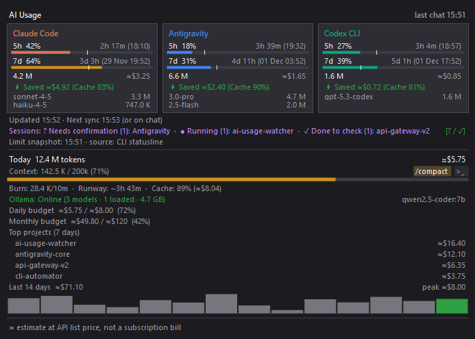
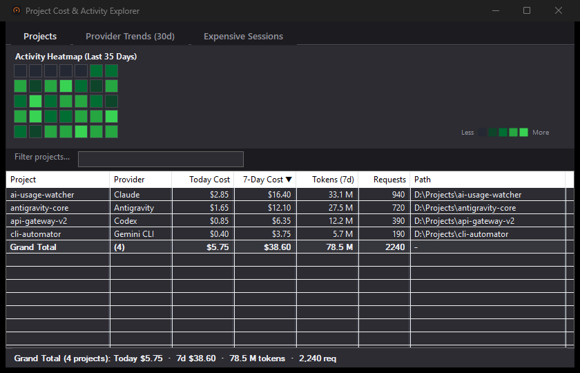
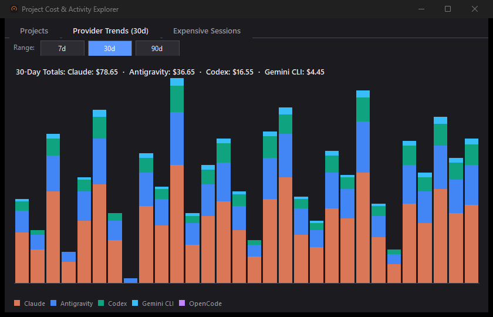
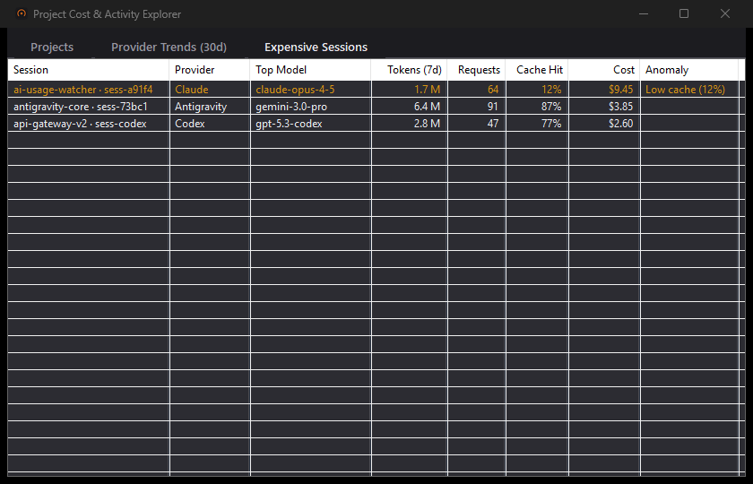
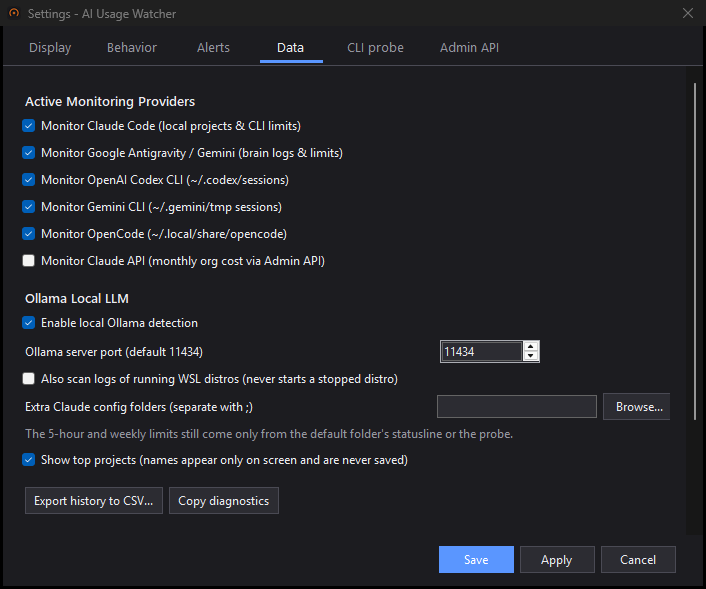
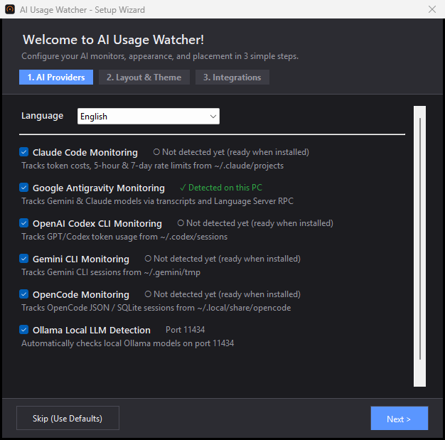
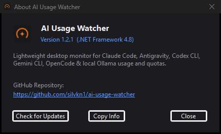

<p align="center">
  
</p>

<h1 align="center">AI Usage Watcher</h1>

<p align="center">
  <em>Real-time Desktop Quota, Session &amp; Token Monitor for Claude Code, Google Antigravity, OpenAI Codex CLI, Gemini CLI, OpenCode &amp; Ollama</em>
</p>

<p align="center">
  <strong>Language / Bahasa:</strong>
  <b>English</b> |
  <a href="README.id.md">Bahasa Indonesia</a>
</p>

<p align="center">
  <a href="https://github.com/silvkn1/ai-usage-watcher/releases"></a>
  <a href="https://github.com/silvkn1/ai-usage-watcher"></a>
  <a href="https://github.com/silvkn1/ai-usage-watcher"></a>
  <a href="LICENSE"></a>
</p>

**AI Usage Watcher** is a lightweight, native Windows desktop HUD and system tray monitor for tracking token consumption, estimated API costs, active AI session states, and rolling quota rate limits across **Claude Code**, **Google Antigravity (Gemini)**, **OpenAI Codex CLI**, **Gemini CLI**, **OpenCode**, and local **Ollama** in real time.

Built with pure C# Windows Forms on the built-in **.NET Framework 4.8** of Windows: single portable executable (~514 KB), zero additional runtime installations, zero external NuGet or Node dependencies, and **zero taskbar clutter** (`WS_EX_TOOLWINDOW`).

---

## 📸 UI Showcase

### 1. Multi-Provider Cards Dashboard & Live Session Monitor (Full Mode)
A parallel dashboard supporting **2-column paged cards (`1/2 ▸`)** or a **3-column grid** (`Claude Code`, `Antigravity`, `Codex CLI`, `Gemini CLI`, `OpenCode`) with balanced card sizing and live activity telemetry.

<p align="center">
  
</p>

- **5-Hour & 7-Day Quota Bars + Pacing Markers**: Countdown timers, exact local reset timestamps, and visual pacing lines showing whether your current burn rate risks hitting limits early.
- **Live Session Activity Badges**: Real-time session state indicators across active AI tools — `?` (**Needs confirmation** / user input), `●` (**Running**), and `✓` (**Done to check**), with a clickable session quick-jump menu (open terminal, folder, VS Code, or acknowledge).
- **Interactive Session Context Bar**: Auto-detects per-model context limits (`200k` / `400k` / `1M`), showing live fill % plus quick **`/compact`** clipboard copy and **`>_`** active terminal launch buttons.
- **Prompt Cache Savings, Ollama VRAM & Sparklines**: Per-provider cache savings breakdown, local Ollama `/api/ps` loaded model + VRAM telemetry, daily/monthly budgets, top projects, and 14/30-day spend sparklines.

---

### 2. Mini HUD Pill & Instant Hover-Expand (Compact Mode)
A sleek 26px floating capsule bar docked at the edge of your screen with customizable pill metrics (`All active providers`, `Highest %`, or `Cost + Runway`) and live session dots (`●` / `?` / `✓`).

<p align="center">
  
</p>

- **Instant Hover-Expand**: Move your cursor over the capsule to expand the full dashboard immediately; move away for 400ms to collapse cleanly back into the pill.
- **Double-Click Lock**: Double-click anywhere outside action buttons to toggle and lock between compact pill and full dashboard modes.

---

### 3. Project Cost Explorer, 30-Day Trends & Anomaly Detector
Built-in 3-tab analytics window (`Project Cost Explorer...` from the tray/context menu) for auditing costs across providers, projects, and sessions.

<p align="center">
  
  
  
</p>

| Projects & 35-Day Heatmap | Stacked Provider Trends | Expensive Sessions Detector |
|---|---|---|
| GitHub-style 35-day contribution heatmap, instant search filter, sortable columns, provider attribution, Grand Total footer, and context menu actions (Folder / Terminal / VS Code / Copy Markdown). | Interactive stacked bar chart comparing daily spend across **Claude**, **Antigravity**, **Codex**, **Gemini CLI**, and **OpenCode** over **7d / 30d / 90d** ranges. | Highlights highest-cost sessions and flags anomalies like **Low cache hit rate (<25%)** or **High cost spikes** so you can optimize prompting workflows. |

---

### 4. Comprehensive Settings GUI (Live Apply)

<p align="center">
  
  
  
</p>

| Display & Layout | Alerts, Webhooks & Quiet Hours | Data Sources, Ollama & Pricing |
|---|---|---|
| Dark/Light/Follow Windows themes, Windows 11 Acrylic/Mica backdrop blur, opacity slider, Remaining mode, 3+ provider card layout, Mini Pill mode, and live Google Finance currency conversion with instant **Apply**. | Quota thresholds (`80,95`), reset alerts, context `>75%` alert, burn-rate spike cooldown, DPAPI-encrypted Discord/Slack/Telegram webhooks + **Test** button, **Quiet Hours**, **Daily/Weekly Digest**, budgets, and Claude Code hooks. | Toggle Claude Code, Antigravity, Codex CLI, Gemini CLI, OpenCode, Ollama (`port`), WSL scanning, CSV/JSON/Markdown exports, `custom_pricing.json` overrides, official pricing fetcher, and secret-free profile Export/Import. |

---

### 5. First-Run Setup Wizard, Right-Click Menu & About Dialog

<p align="center">
  
  
  
</p>

| Setup Wizard (3 Steps) | Grouped Right-Click Menu | About Dialog |
|---|---|---|
| Auto-detects installed AI tools, sets language & theme/backdrop/corner dock, and optionally installs the VS Code / Cursor companion extension. | Cleanly grouped submenus (**View & Layout**, **Reports & Tools**, **Help & About**) on both system tray icon and floating widget, plus quick project folder/terminal shortcuts. | Accessible via **Help & About -> About...** — shows current version, runtime, trusted GitHub repository link, one-click update check, and clipboard version copy. |

---

## 🏆 Why AI Usage Watcher? (Comparison with Other Solutions)

Most AI monitoring tools (such as `ccusage`, `cclimits`, or CLI statusline scripts) are terminal-only utilities, restricted to a single AI provider, or built on heavy Electron runtimes. **AI Usage Watcher** is built specifically for Windows developers who want instant, passive, zero-overhead visibility.

| Feature / Dimension | **AI Usage Watcher** (This App) | **CLI Utilities** (e.g., `ccusage`) | **Built-in Statuslines** | **Electron GUI Apps** |
| :--- | :---: | :---: | :---: | :---: |
| **Provider Support** | **Claude + Antigravity + Codex + Gemini CLI + OpenCode + Ollama** | Claude Code only | Claude Code only | Typically 1 provider |
| **Interface (UI)** | **Mini HUD Pill (26px) + 3-Col/Paged Cards + Explorer** | Terminal text (manual run) | Terminal status bar | Heavy window / webview |
| **Live Session Badges** | **Yes** (`?` confirm, `●` running, `✓` done + jump menu) | None | None | None |
| **Dynamic System Tray** | **Yes** (live 5h badge % & color + hover popup) | None | None | Rare / static icon |
| **Binary Size** | **~514 KB** (Single Standalone `.exe`) | ~5 - 50 MB (Node.js/npm) | Bash/PowerShell scripts | 150 MB - 300 MB+ |
| **Memory Footprint (RAM)** | **~20 - 35 MB** (Native .NET 4.8) | Absorbed in CLI runtime | 0 MB (print only) | 200 MB - 600 MB+ |
| **External Dependencies** | **Zero** (Windows 10/11 built-in) | Requires Node.js / Python | Requires CLI wrapper | Requires Node / Chromium |
| **Runway Quota Forecast** | **Yes** (`Runway: ~3h 43m` + pacing marker) | None | None | None |
| **Auto Currency Conversion** | **Yes** (Live Google Finance to local currency) | None (USD only) | None | Limited / Manual |
| **Official Antigravity Connect-RPC** | **Yes** (Direct Language Server RPC) | None | None | None |
| **Click-Through & Zero Taskbar** | **Yes** (`WS_EX_TOOLWINDOW` & transparent) | N/A | N/A | Clutters taskbar & `Alt+Tab` |
| **Reporting & Exporting** | **30d Trends, Anomaly Detector, `.md`, CSV & JSON** | Limited JSON/text | None | Basic CSV |
| **Alerts & Webhooks** | **Audio chimes, Quiet Hours, Scheduled Digest, Discord/Slack/Telegram** | None | None | Plugin-dependent |
| **Code & Prompt Privacy** | **100% Local** (prompts discarded before parse) | 100% Local | 100% Local | Varies / Telemetry |

---

## ✨ Core Features

### 📊 Multi-Provider AI Monitoring
- **Local Claude Code Logs (`~/.claude/projects/**/*.jsonl`)**: Incrementally parses prompt, output, and cache tokens with cross-file `message.id | requestId` deduplication, tool-confirmation (`AskUserQuestion` / `ExitPlanMode`) tracking, and hook support for permission prompts.
- **Local Antigravity Logs (`~/.gemini/antigravity/brain/**/transcript.jsonl`)**: Real-time transcript scanner for Gemini & Claude models via Antigravity (including `transcript_full.jsonl` fallback on truncated records and `BlockedOnUser` confirmation detection).
- **Local OpenAI Codex CLI Logs (`~/.codex/sessions/**/rollout-*.jsonl`)**: Parses Codex session metadata, `turn_context`, incremental `last_token_usage`, 5-hour / weekly `rate_limits`, plus WSL2 session auto-discovery.
- **Gemini CLI & OpenCode Scanners**: Tracks Gemini CLI (`~/.gemini/tmp/**/chats/session-*.json`) and OpenCode (`~/.local/share/opencode/storage/message/**/*.json`, plus optional read-only `sqlite3` CLI query when installed on PATH) with persistent byte-offset caching (`scan_cache.json`).
- **Local Ollama & VRAM Detector (`/api/tags` & `/api/ps`)**: Configurable port (default `11434`), displays live online badge, model count, currently loaded models and VRAM usage (`GB`).
- **Official Connect-RPC Antigravity Quota**: Retrieves remaining quota directly from the background Antigravity Language Server (`RetrieveUserQuotaSummary`) via local daemon discovery in `hub_*.json`.
- **Flexible Card Layouts & Customization**: Switch between automatic layout, 2-column pager (`1/2 ▸`), or 3-column grid; customize Mini HUD Pill mode (`All`, `Highest %`, `Cost + Runway`); independently toggle any provider in Settings or Setup Wizard.

### ⚡ Productivity, Companion IDE & Reporting
- **VS Code & Cursor Status Bar Companion**: One-click installation from the tray menu copies the lightweight extension to `%USERPROFILE%\.vscode\extensions` and `%USERPROFILE%\.cursor\extensions`. Displays live quota %, cost, and cache savings in the editor status bar, with a click Quick Pick menu to force refresh, open Project Cost Explorer, toggle compact/full mode, or copy `/compact` and status summaries.
- **Windows 11 Mica & Acrylic Blur**: Native Desktop Window Manager (DWM) translucency (**Acrylic Blur**, **Mica**, **Mica Alt**, or **Solid**) with Win11 rounded corners and Per-Monitor DPI awareness.
- **Multi-Monitor Snap & 4-Corner Docking**: Snap the widget to any monitor and dock to all 4 corners (**Top-Left**, **Top-Right**, **Bottom-Left**, **Bottom-Right**) or edge centers.
- **Interactive Context Window & Quick Actions**:
  - Click `/compact` on the Context Bar to copy `/compact`; click `>_` to open terminal in the active project directory (`LastActiveCwd`).
  - Double-click the Claude card to launch terminal (`wt.exe` preferred), Antigravity card to open storage folder, or outside area to toggle Pill/Full mode.
- **Custom Pricing Overrides (`custom_pricing.json`)**: Override token rates per 1M tokens for OpenRouter, Bedrock, Vertex AI, proxies, or custom models — takes priority over `pricing.json` and official auto-fetched pricing.
- **Scheduled Exports & Companion Status JSON**: Export daily aggregates as CSV (standard or regional Excel `;`), raw JSON history, monthly `AI_Usage_Report_YYYY_MM.md` reports, and live `~/.ai-usage-status.json` for external scripts/tmux/prompts.
- **Portable Configuration Profiles**: Export or import Settings JSON profiles with sensitive credentials (Admin API keys & webhook URLs) automatically stripped.
- **Global Hotkey**: `Win+Alt+U` (automatic fallback to `Ctrl+Alt+U`) toggles widget visibility from anywhere in Windows.

### 🔔 Smart Notifications & Automation
- **Session Activity & Confirm Alerts**: Detects when Claude Code or Antigravity pauses waiting for user confirmation (`?`) or finishes a long run (`✓`), raising the `?` badge plus optional toast/audio/webhook notifications.
- **Threshold & Reset Notifications**: Configurable quota thresholds (default `80,95`), reset toast notifications, context window warning (`>75%`), and 10-minute burn-rate spike detection with configurable alert cooldown.
- **Discord / Slack / Telegram Webhooks**: Auto-formats payloads per platform, tests connections live in Settings, respects **Quiet Hours** schedules, and supports **Daily / Weekly Scheduled Digests**.
- **Built-in Auto-Updater**: Checks GitHub Releases asynchronously with HTTPS strict host pinning, release SHA-256 checksum verification, and Authenticode PE signature validation.

---

## 🚀 Quick Start & Installation

### Requirements
- Windows 10 (version 1903+) or Windows 11.
- .NET Framework 4.8 (pre-installed natively on Windows).
- One or more supported tools: Claude Code CLI, Google Antigravity, OpenAI Codex CLI, Gemini CLI, OpenCode, or Ollama.

### Automated Installation
1. Download the latest `AIUsageWatcher-<version>.zip` from [Releases](https://github.com/silvkn1/ai-usage-watcher/releases) or build from source.
2. Extract the archive, open PowerShell in that folder, and run:
   ```powershell
   powershell -NoProfile -ExecutionPolicy Bypass -File .\install.ps1 -Statusline -Autostart
   ```
   *Optional parameters:*
   - `-Autostart`: Launches the widget automatically on Windows startup.
   - `-Statusline`: Installs the Claude Code CLI statusline wrapper for automatic 5h/7d rate limit telemetry.
   - `-InstallDir <path>`: Sets a custom installation directory (default: `%LOCALAPPDATA%\Programs\AIUsageWatcher`).

3. Done! The application launches in the system tray and opens the 3-step Setup Wizard on first run.

> **Tip for Claude Code tool-permission `?` alerts**: In **Settings -> Alerts** (or Setup Wizard), click **Install hooks** so Claude Code's `Notification` hook notifies the watcher immediately on `Bash`/`Edit`/`Write` approval prompts.

### Portable Mode (Zero Installation)
Place an empty file named `portable.flag` next to `AIUsageWatcher.exe`. The app stores all config, history, cache, and logs inside a local `.\data` folder without touching the Windows Registry.

---

## 🛠️ Building from Source

The project compiles using Windows built-in `.NET Framework 4.8` compilers (`csc.exe`) with zero Visual Studio or third-party package requirements:

```powershell
# Compile binary (outputs dist\AIUsageWatcher.exe)
powershell -NoProfile -ExecutionPolicy Bypass -File .\build.ps1

# Compile full distribution release package (.zip + SHA256SUMS.txt)
powershell -NoProfile -ExecutionPolicy Bypass -File .\build.ps1 -Package

# Execute 89 automated unit tests
powershell -NoProfile -ExecutionPolicy Bypass -File .\test.ps1
```

---

## 📁 Repository Structure

```
ai-usage-watcher/
├── src/
│   ├── AudioAlert.cs          # Threshold audio chime manager
│   ├── AutoUpdater.cs         # GitHub Releases auto-updater, SHA-256 & Authenticode PE check
│   ├── Common.cs              # System paths, formatting, JSON parser, and ProcessHelper
│   ├── CompanionInstaller.cs  # Installer & sync for VS Code / Cursor companion extension
│   ├── Config.cs              # Configuration model, DPAPI encryption & secret-free profile I/O
│   ├── Diag.cs                # Privacy-redacted diagnostic report builder
│   ├── FloatingForm.cs        # Floating HUD window (3-col/paged cards, Pill, Context Bar, GDI+)
│   ├── History.cs             # Self-contained 120-day historical ledger, CSV & JSON exports
│   ├── Hooks.cs               # Global keyboard shortcut & Claude Code hook listener
│   ├── LangPacks.cs           # External JSON language pack loader
│   ├── Logic.cs               # Threshold evaluation, pacing, runway, Quiet Hours, Digest & Markdown reports
│   ├── Probe.cs               # Headless CLI probe executor for Claude Code rate limits
│   ├── Program.cs             # Windows Forms entry point & single-instance mutex
│   ├── ProjectExplorerForm.cs # Project Explorer: 35d heatmap, 30d Provider Trends & Expensive Sessions
│   ├── SettingsForm.cs        # Tabbed settings dialog with live Apply preview
│   ├── SetupWizardForm.cs     # 3-step first-run onboarding wizard
│   ├── Sources.cs             # Rate limit reader, Official Pricing fetcher, Ollama & Connect-RPC client
│   ├── Strings.cs             # Bilingual localization engine (English & Bahasa Indonesia)
│   ├── Theming.cs             # Color palettes, Win11 DWM Mica/Acrylic & app icon extractor
│   ├── TrayApp.cs             # Dynamic tray icon, watchers, grouped context menus & About dialog
│   ├── Usage.cs               # Incremental log & session state scanner (Claude/AG/Codex/GeminiCLI/OpenCode)
│   └── Webhook.cs             # SSRF-hardened alert dispatcher (Discord, Slack, Telegram & Generic)
├── companion/                 # VS Code & Cursor status bar extension
├── statusline/                # Statusline wrapper scripts for Claude Code CLI (PowerShell & Bash)
├── tests/
│   └── UnitTests.cs           # 89 automated unit tests (.NET 4.8 test runner)
├── assets/                    # Application logo assets (vector PNG & .ico)
├── docs/img/                  # Feature documentation screenshots
│   ├── en/                    # English UI screenshots
│   └── id/                    # Indonesian UI screenshots
├── app.ico                    # Windows executable application icon
├── app.manifest               # DPI awareness and execution permissions manifest
├── pricing.json               # Built-in official API token pricing tables
├── build.ps1                  # Automated build script using native csc.exe
├── test.ps1                   # Automated test runner script
├── install.ps1                # Per-user installer and statusline registration script
└── uninstall.ps1              # Clean uninstaller script (optional user data wipe)
```

---

## 🔒 Privacy & Data Security

- **100% Local Processing**: All conversation logs are processed strictly on your local machine. No analytics servers, telemetry, or prompt contents are ever uploaded.
- **Prompt Sanitization**: The log scanner extracts only metadata (`usage`, `model`, `timestamp`, tool confirmation flags, `cwd`). Prompt and response bodies are discarded in memory and never written to disk.
- **DPAPI Credential Encryption**: Admin API keys and webhook URLs are encrypted using Windows DPAPI (*Data Protection API*), scoped to your current Windows user profile.
- **Hardened Update & Network Boundaries**: Auto-updater enforces HTTPS `github.com` / `api.github.com` hosts, SHA-256 verification, and Authenticode signature checks; webhook & localhost clients enforce strict SSRF and host-allowlist validation.
- **Release Integrity & Code Signing Policy**: Tagged CI builds publish GitHub Build Provenance Attestations and support free OSS Authenticode signing via [SignPath.io](https://signpath.io/) / [SignPath Foundation](https://signpath.org/) — see [`CODE_SIGNING_POLICY.md`](CODE_SIGNING_POLICY.md).

---

## 📄 License

Distributed under the [MIT License](LICENSE). Free to use, modify, and distribute.
